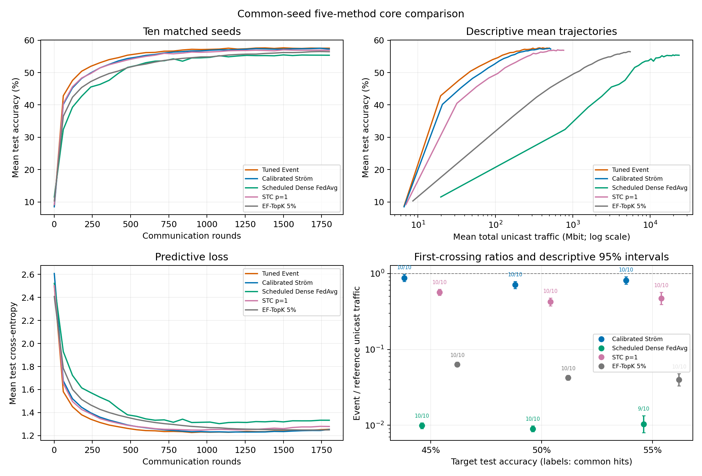

# Common-seed numerical core: results and paper decision

Evidence: `experiments/results/core_fresh_comparison_v1/`, results commit
`04243a1f04ced7891533d43f13345fb941f93ae7`. The full core contains **30 new
Dense/STC/EF-TopK runs and 20 verified reused Event/Ström controls** on the same
ten partition seeds 6000–6900 and SGD seeds 86000–86900. Each run uses 1800
communication rounds, the compact CIFAR CNN (20570 parameters), ten fully
participating clients, strong 55%-dominant label skew, all 50000 training images
and the fixed 10000-image official test set. Shared local SGD, initialization,
regularization and evaluation cadence match the protocol in
[`CORE_FRESH_COMPARISON.md`](CORE_FRESH_COMPARISON.md).

## Conclusion

**Event has the lowest final unicast traffic and highest mean final accuracy
among the five tested operating points. Its strongest numerical distinction
is lower communication to declared predictive accuracy.** At 50% test accuracy,
Event uses fewer unicast bits in all ten paired seeds against every comparator.
The paired geometric-mean savings are **29.23% versus calibrated Ström, 57.75%
versus STC p=1, 95.77% versus EF-TopK 5%, and 99.10% versus scheduled Dense**.
All five methods reach this target in every run.

Ström remains the closest comparator. Event's final saving over it is **3.91%
[3.01%, 4.79%]**, whereas its saving to 50% accuracy is **29.23% [21.01%,
36.58%]**. The final-accuracy difference remains unresolved: **+0.267
percentage points [-0.435, +0.969]**. This prevents claiming predictive
superiority or formal equivalent accuracy against the closest pulse baseline.

The common-seed numerical core is complete. Freeze these operating points and
integrate the communication protocol, comparator definitions and complete
results into the manuscript. The supported empirical claim is lower unicast
communication to useful predictive accuracy in this matched setting. A generic
convergence-rate, wall-clock, universal method-ranking or field-wide SOTA claim
does not follow from this study.

## Final quality and traffic

Accuracy and CE are mean +/- sample standard deviation across ten seeds.
Traffic is the arithmetic mean in Mbit, including initialization, actual
frames/padding, client requests and unicast replication. Event/Ström use
`both_codecs`, Dense uses `dense_float32`, STC uses `lossless_stc`, and EF-TopK
uses `lossless_ef_topk`. Ratios below are separately computed within paired seeds.

| Method | Test accuracy, % | Test CE | Upload | Download | Total unicast |
|---|---:|---:|---:|---:|---:|
| Tuned Event | 57.546 +/- 0.490 | 1.254556 +/- 0.013995 | 73.44 | 426.00 | 499.44 |
| Calibrated Ström | 57.279 +/- 0.659 | 1.252853 +/- 0.016318 | 77.68 | 442.07 | 519.75 |
| STC p=1, gain 2 | 56.893 +/- 0.860 | 1.279343 +/- 0.023396 | 378.70 | 385.78 | 764.48 |
| EF-TopK 5%, gain 1 | 56.447 +/- 0.818 | 1.249602 +/- 0.017705 | 722.51 | 4816.39 | 5538.90 |
| Scheduled Dense FedAvg | 55.365 +/- 0.637 | 1.333359 +/- 0.027053 | 11849.47 | 11856.63 | 23706.10 |

The Dense server gain is the previously selected `4*(1+r/100)^(-0.3)` schedule.
STC p=1 is dense ternary communication with client/server error feedback, not
full-precision Dense FedAvg. EF-TopK retains native global 5% support selection,
weighted client residuals and float32 values; its lossless support and aggregate
downlink extension preserves the native optimization trajectory.

| Reference | Event-minus-reference accuracy, pp [95% interval] | Event-minus-reference CE [95% interval] | Event final unicast reduction [95% interval] |
|---|---:|---:|---:|
| Ström | +0.267 [-0.435, +0.969] | +0.001703 [-0.015934, +0.019339] | 3.91% [3.01%, 4.79%] |
| STC p=1 | +0.653 [+0.031, +1.275] | -0.024786 [-0.040574, -0.008998] | 34.68% [33.80%, 35.54%] |
| EF-TopK 5% | +1.099 [+0.520, +1.678] | +0.004954 [-0.005786, +0.015694] | 90.98% [90.89%, 91.08%] |
| Scheduled Dense | +2.181 [+1.532, +2.830] | -0.078803 [-0.098226, -0.059380] | 97.89% [97.87%, 97.92%] |

These intervals are descriptive, paired, unadjusted 95% Student-t intervals;
cost ratios use the log scale and are transformed as `100*(1-ratio)`. Event
uses fewer final total bits in **10/10 pairs against every reference**. It has
higher accuracy in 7/10 versus Ström, 8/10 versus STC, 9/10 versus EF-TopK and
10/10 versus Dense. The STC accuracy interval only narrowly excludes zero before
accounting for multiple comparisons; it should not become a headline claim of
statistically established predictive superiority.

EF-TopK has the lowest mean final CE. Event has lower CE in 3/10 pairs versus
EF-TopK and 5/10 versus Ström, with unresolved mean differences. It has lower
CE in all ten pairs versus STC and Dense. Accuracy and CE give different views
of predictive quality; the communication story should keep both visible.

The STC comparison also shows a directional tradeoff: Event uploads **80.61%
fewer bits** but downloads **10.41% more** on the paired geometric scale. Its
34.68% total saving therefore does not imply a saving in both directions.
Against Ström, Event saves in both directions. Logical-broadcast accounting
also favours Event's final total cost against all four comparators; it remains
supplementary and is not a measured multicast, latency or energy result.

## Communication to the declared targets

All methods reach 45% and 50% accuracy on all ten seeds. At 55%, Event, Ström,
STC and EF-TopK reach 10/10, while Dense reaches **9/10**. Dense partition
6000 never reaches 55% by round 1800 and remains censored. Its 55% target-cost
ratio is conditional on nine common hits; the missing achievement has no
imputed free or zero cost.

| Reference | Event saving to 45% [95% interval] | Event saving to 50% [95% interval] | Event saving to 55% [95% interval] |
|---|---:|---:|---:|
| Ström | 12.53% [2.62%, 21.42%] | 29.23% [21.01%, 36.58%] | 18.79% [8.70%, 27.76%] |
| STC p=1 | 43.36% [38.11%, 48.15%] | 57.75% [52.65%, 62.31%] | 53.08% [43.41%, 61.09%] |
| EF-TopK 5% | 93.65% [93.21%, 94.07%] | 95.77% [95.44%, 96.07%] | 96.02% [95.19%, 96.70%] |
| Scheduled Dense | 99.01% [98.92%, 99.09%] | 99.10% [99.02%, 99.17%] | 98.96% [98.67%, 99.20%], 9 pairs |

At the 50% target, the arithmetic-mean crossing costs and rounds are:

| Method | Mean first saved round | Mean unicast Mbit | Target coverage |
|---|---:|---:|---:|
| Event | 198 | 51.94 | 10/10 |
| Ström | 270 | 73.32 | 10/10 |
| STC p=1 | 276 | 122.80 | 10/10 |
| EF-TopK 5% | 420 | 1224.48 | 10/10 |
| Scheduled Dense | 438 | 5773.47 | 10/10 |

Event reaches 50% in fewer sampled rounds in 9/10 pairs versus Ström and STC
(one tie each), and 10/10 versus EF-TopK and Dense. At 55%, Event is later and
more expensive than Ström on partitions 6700 and 6800. Its advantage is therefore
a paired average result, not universal dominance over every individual seed.

Targets were fixed before confirmation. Crossings are the first saved
evaluations at round 1 or a multiple of 60, without interpolation. The
crossings can overshoot and subsequent accuracy may fall below the target.
They are retrospective diagnostics, not test-driven early stopping. The mean
trajectory plot is descriptive and does not define the paired target estimand.



## Codec and regularization diagnostics

The results give every comparator its declared lossless representation. EF-TopK's
mean final unicast cost falls from **9586.40 to 5538.90 Mbit** under its support
and exact aggregate downlink extension, a mean per-seed reduction of 42.22%.
The final exact aggregate downlink is chosen in all 18000 EF-TopK seed/round
instances. Its remaining gap to Event is therefore not a comparison against an
uncoded fixed-address baseline alone. This is still the tested 5% EF operating
point, not an optimized frontier over every retained fraction or server protocol.

STC's native-to-lossless mean cost falls from 1511.38 to 764.48 Mbit. The pulse
methods also benefit substantially from shared coding. The representation
improvement is useful across algorithms and cannot be assigned exclusively to
Event's state/reset mechanism.

Event has the lowest mean training CE (0.924106), followed by STC (0.932416),
Dense (0.948483), Ström (0.957751) and EF-TopK (1.035834). However, its mean
regularized objective is **1.187239**, versus 1.153873, 1.006410, 0.990065 and
1.079154 for Ström, Dense, STC and EF-TopK, respectively. Event's larger L2
penalty (0.263134) drives this distinction. The study supports communication to
predictive accuracy, not superior minimization of the common regularized
training objective or an isolated causal explanation for generalization.

## Audit, limits and next step

The audit verifies all **30 complete new receipts and 20 reuse receipts**,
**90000 round records** and **1550 sampled model fingerprints**. It reproduces
all eight original analysis CSVs; independently checks frame counters, every
traffic prefix/endpoint, paired intervals and hit coverage; and checks first
crossings against raw evaluations. The Event/Ström contrast exactly reproduces
the completed fresh confirmation. All ten seed pairs are retained, including
the censored Dense target. The twelve original analysis tables/audits/figures
and the original pulse evidence remain unchanged.

The audit reads saved counters/metrics and hashes, not raw images, packet bytes
or NPZ model weights. Execution-time byte decoding/client reconstruction and
synthetic native trajectory checks belong to the frozen runners. Uncertainty
is across partition/SGD variation on one previously inspected fixed test set.
The five families have different historical selection criteria/budgets: this
is a matched evaluation of frozen settings, not a claim of equal tuning effort.
STC p=0.25 and alternative EF fractions are outside this core. Broader
architecture, participation or deployment claims need matching evidence.

The next step is manuscript consolidation: present the five-method endpoint
table and paired target-cost results, retain calibrated Ström as the nearest
comparator, update Table I and explain each native method versus its lossless
transport extension. Keep STC's downlink advantage, CE uncertainty and target
censoring explicit. A publication figure should be regenerated from the frozen
tables rather than modifying the original diagnostic output. New manuscript
changes should remain coloured for review. Further robustness experiments should
answer a specific broader claim after this core is integrated; no additional
tuning or large parameter sweep is justified by the present results.

Reproduce the audit without training or rewriting the original analysis:

```bat
python experiments/core_fresh_comparison_audit.py
git add experiments/results/core_fresh_comparison_v1
git commit -m "Refresh common-seed core comparison evidence audit"
git push origin main
```
