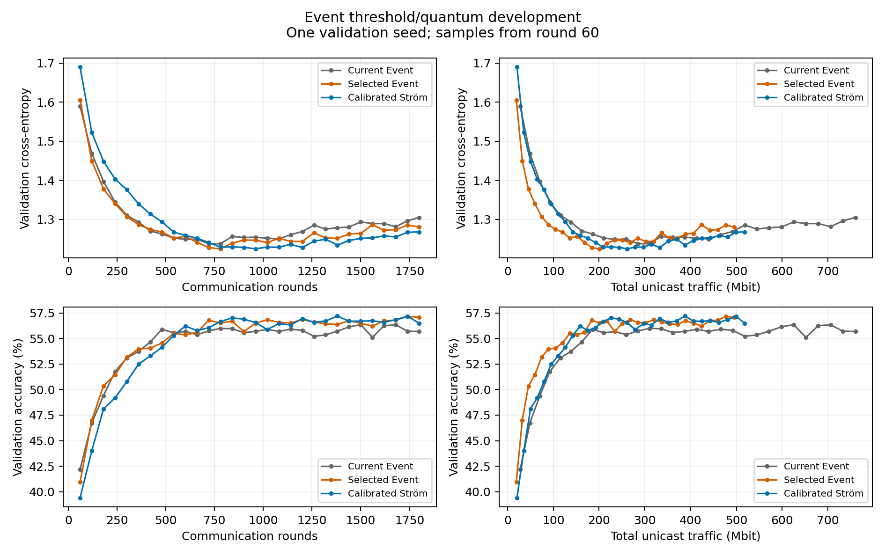

# Event threshold/quantum development: results and decision

Evidence: `experiments/results/event_codec_development_v1/`, results commit
`7d018da`. One development partition/SGD seed (4500/84500), compact CIFAR CNN
(20570 parameters), ten fully participating clients, strong label skew,
45000 training images and 5000 genuinely held-out validation images. This is
additional development after inspecting the earlier confirmation results.
No official test images or confirmation test curves enter this campaign.

## Decision

**Joint threshold/quantum tuning materially improves the Event operating
point.** Freeze **threshold 0.05 and initial quantum 0.01**, with leak 0.999,
full reset, persistent state, quantum exponent 0.2 and server gain 1 unchanged.
The selected point fills both the final quality and within-Ström-budget roles.

At round 1800, selected Event uses **34.87% less unicast traffic** than current
Event, gains **1.40 percentage points** validation accuracy and has lower CE.
Against calibrated Ström, it uses **4.44% fewer bits** and has **0.58 percentage
points higher accuracy**, but **worse validation CE**. It is therefore a
competitive development operating point, not a win on every predictive metric.

The declared search has produced a useful setting to confirm. Preserve the
completed ten-seed evidence for old Event unchanged; it describes that frozen
configuration. These new results do not establish a corresponding test-set or
multi-seed improvement. The next step is a separately declared fresh paired
confirmation of selected Event against calibrated Ström, with both frozen.

## Selection and search coverage

All **15 Event candidates** complete their 600-round screen: fourteen new
trajectories and one reused current Event setting. The calibrated Ström control
is also reused. No numerical failure or pending candidate is dropped.

At round 600:

- The quality rule selects current Event (threshold 0.025 / quantum 0.005):
  validation CE 1.249093, total 234.42 Mbit.
- The within-Ström-budget rule selects threshold 0.05 / quantum 0.01:
  validation CE 1.256814, total 151.49 Mbit, below Ström's 158.68 Mbit budget.

These two Event IDs are promoted. Current Event already has a verified
1800-round validation run, so **only one new finalist continuation** is needed.
At round 1800, threshold 0.05 / quantum 0.01 has lower CE than current Event
and fits Ström's 518.02 Mbit budget; both Event selection roles consequently
coincide. This follows the frozen rules, without manual promotion or an
accuracy-based replacement of the CE criterion.

The constrained screening role matters: a quality-only 600-round screen would
have retained the old setting and missed this long-horizon improvement.
Selection at round 1800 remains among the promoted candidates, not all fifteen
grid points. The selected quantum is the **upper grid boundary**, while its
threshold is interior. There is no automatic boundary extension and no claim
of global optimality. Preserve that declared budget instead of expanding the
grid after seeing a favourable outcome.

## Quality and communication at fixed horizons

All metrics below are **validation** metrics on one development seed. Traffic
is conservative unicast Mbit with `both_codecs`, including model initialization,
complete frames/padding, requests and receiver replication. Both pulse methods
receive the same frozen lossless representation opportunities.

| Horizon | Method | Validation accuracy | Validation CE | Upload | Download | Total |
|---|---|---:|---:|---:|---:|---:|
| 600 | Current Event | 55.68% | 1.249093 | 39.95 | 194.47 | 234.42 |
| 600 | Selected Event | 55.36% | 1.256814 | 22.05 | 129.44 | 151.49 |
| 600 | Calibrated Ström | 56.22% | 1.259028 | 23.28 | 135.40 | 158.68 |
| 1800 | Current Event | 55.68% | 1.305046 | 131.26 | 628.81 | 760.07 |
| 1800 | Selected Event | 57.08% | 1.280624 | 73.22 | 421.78 | 495.00 |
| 1800 | Calibrated Ström | 56.50% | 1.268014 | 77.52 | 440.50 | 518.02 |

At round 600 the selected point trades slightly worse quality than current
Event for **35.38% lower traffic**. At round 1800 it improves both quality
metrics and traffic relative to current Event. This validates the usefulness
of revisiting the operating point for the longer horizon and new accounting.

Relative to current Event, selected Event's final upload reduction is **44.21%**,
download reduction **32.92%**, and total reduction **34.87%**. The CE difference
is -0.024421. Relative to Ström, upload reduction is **5.54%**, download reduction
**4.25%**, and total reduction **4.44%**, while CE is **0.012611 higher**.
The supplementary logical-broadcast totals are 115.34 Mbit for selected Event,
121.51 for Ström and 194.08 for current Event. Its broadcast saving is 5.08%
relative to Ström; unicast remains the primary result.

The comparison with Ström is an observed accuracy/CE tradeoff. Accuracy uses
the most likely class; CE also depends on the assigned probabilities. Neither
metric should be omitted to create a blanket predictive-superiority claim.
The validation data selected this operating point, and there is only one seed:
no significance, equivalence or generalization claim follows from these gaps.

The prior ten-seed comparison used all 50000 training images and the official
test set. Its test scores cannot be mixed with these validation scores to rank
selected Event against STC or to claim a new state of the art.

## Communication to fixed accuracy targets

Use the same 45%, 50% and 55% thresholds as earlier analyses, now as
retrospective **validation diagnostics**. First crossings are sampled at round
1 or a multiple of 60, without interpolation or an implemented early-stopping
policy. All three long trajectories reach every target. The accuracies at
crossing can overshoot differently and can later fall below the target.

| Validation target | Selected Event round | Event, Mbit | Ström round | Ström, Mbit | Event saving |
|---|---:|---:|---:|---:|---:|
| At least 45% | 120 | 32.15 | 180 | 50.04 | 35.74% |
| At least 50% | 180 | 45.57 | 300 | 79.83 | 42.91% |
| At least 55% | 540 | 135.63 | 540 | 142.34 | 4.71% |

The selected Event setting needs fewer sampled rounds than Ström at 45% and
50%, and the same sampled round at 55%. Its traffic is smaller at all three
crossings on this seed. The high-target margin is much smaller than the early
one, so confirmation should retain all targets and complete hit coverage.

Relative to current Event, target-cost reductions are 34.27%, 50.76% and 26.98%.
At 55%, current Event crosses earlier (480 versus 540 rounds), but selected
Event still costs less. Fewer rounds and fewer communicated bits remain
distinct observations. No wall-clock or energy measurement is inferred.



Validation CE eventually increases for both selected Event and Ström while
training CE falls. The selected point improves the trajectory without closing
that issue. These curves do not change the fixed round-1800 selection into
post-hoc best-checkpoint reporting.

## Pulse granularity and regularization diagnostics

The selected point **doubles both threshold and initial quantum**. Its nominal
`q(r)/threshold` ratio is unchanged because the schedule exponent/scale and
server gain are fixed. This is not merely an increase in server gain. Larger
trigger and jump scales change pulse timing, reset losses and the subsequent
model trajectory, so an identical ratio does not imply identical optimization.

The observed communication change is consistent with fewer, larger pulses:
current Event emits 19.05 million coordinate pulses over 1800 rounds, versus
**9.03 million** for selected Event, a **52.62%** reduction. Ström emits 9.70
million. Late-120-round firing fractions are 5.67%, 2.71% and 2.97% of
client-coordinate opportunities for current Event, selected Event and Ström.
These are diagnostics of the joint parameter change, not an isolated causal
test of leak, reset or overshoot handling.

All three methods choose counts-plus-float32-corrections in every round, with
no ordered fallback. Corrections cost 4.41 Mbit for selected Event, 7.74 Mbit
for Ström and 12.77 Mbit for current Event. The saving relative to current Event
therefore reflects substantially fewer pulses, not removal of exact-fidelity
corrections. Those corrections remain part of all reported costs.

Training diagnostics at round 1800 on the fixed training subset are:

| Method | Regularized objective | Training CE | L2 penalty | Inferred parameter norm |
|---|---:|---:|---:|---:|
| Current Event | 1.405356 | 0.933394 | 0.471962 | 43.45 |
| Selected Event | 1.168171 | 0.920034 | 0.248137 | 31.50 |
| Calibrated Ström | 1.187998 | 0.973363 | 0.214635 | 29.30 |

The regularization coefficient remains 0.0005 for every method. Selected Event
has lower training CE and a smaller penalty than current Event. Its training
objective is also slightly lower than Ström's, while its validation CE is worse.
Training-objective improvements cannot substitute for predictive confirmation.

## Audit and next step

The audit verifies **fifteen new completion receipts** (fourteen screens and
one full continuation), **four reused reference stages**, **15000 archived
round records**, and **269 evaluated model fingerprints**. All three full
trajectories reproduce their 600-round round/evaluation/history prefixes exactly,
apart from timing and stage metadata. Unique coverage is 13200 trajectory rounds
and 236 evaluated models; screening prefixes are archived again in full runs.

Independent counter reconstruction verifies every history/endpoint cost for all
four encoding variants. The frozen screen/final decisions and three original
ledger CSVs reproduce, and the original analysis files/figures remain unchanged.
The audit reads saved CSV/JSON evidence; it does not reload raw images, packet
bytes, NPZ weights or Event/residual arrays. Live decoding and client/server
model equality belong to the frozen execution checks.

Freeze threshold 0.05 / initial quantum 0.01 for the next comparison. Refit it
from round 1 on the full training set and compare with frozen calibrated Ström
using **fresh matched partition/SGD seeds**, the same 1800-round endpoint, both
accuracy and CE, direction-specific traffic, and the same target-cost coverage.
Do not continue the validation checkpoint or relabel the previously inspected
confirmation seeds as fresh evidence. The fixed official test dataset has
already been inspected, which should remain explicit in the interpretation.

This study supplies a competitive operating point to confirm. It does not yet
restore a general faster-convergence or communication-superiority claim for the
paper, and it does not isolate a distinctive Event mechanism. There is no need
to tune leak or the quantum schedule before assessing transfer of this frozen
choice. Keep calibrated Ström as the fixed comparator.

Reproduce the audit without training or overwriting the original analysis:

```bat
python experiments/event_codec_development_audit.py
git add experiments/results/event_codec_development_v1
git commit -m "Refresh Event threshold quantum development analysis"
git push origin main
```
