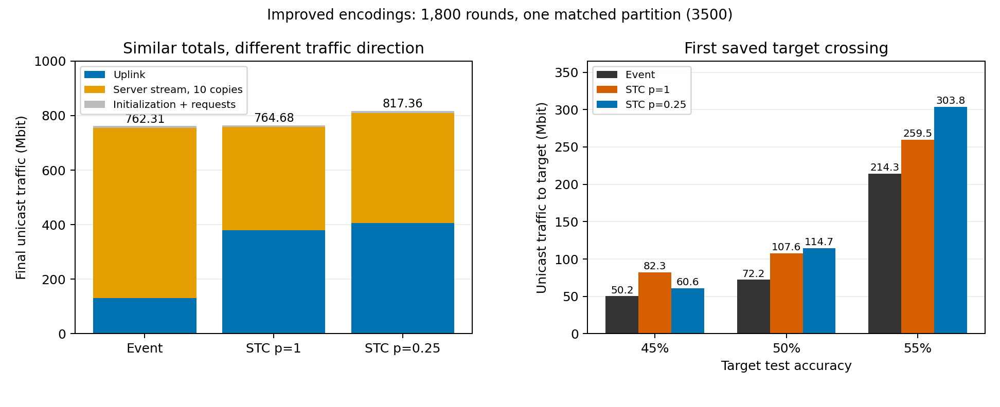

# Full-horizon codec diagnostic: results and decision

The ten-seed follow-up is now complete. See
[`EVENT_CODEC_TEN_SEED_RESULTS.md`](EVENT_CODEC_TEN_SEED_RESULTS.md) for the
confirmation and current decision. The single-seed findings below record the
earlier diagnostic.

Evidence: `experiments/results/event_codec_full_horizon_v1/`, results commit
`9b3cc73`. One fixed evaluation partition (3500), SGD seed 83500, compact CIFAR
CNN, ten fully participating clients, 1800 rounds. Settings are frozen and final
round 1800 is the endpoint. No test-based selection or confidence interval.

## Main conclusion

The codec gain persists through full training: Event total conservative-unicast
traffic falls from **3359.14 to 762.31 Mbit**, a **77.31% reduction**, while
preserving its updates and predictions. Relative to STC with the same lossless
coding opportunities, Event has a useful early accuracy-per-bit advantage.
Its final unicast cost and classification accuracy are essentially tied with
STC p=1. The p=.25 comparison favours Event on this seed.

This closes the full-horizon, single-seed codec diagnostic. The next priority is
to inspect the existing ten-seed predictive confirmation before deciding whether
an algorithm change is needed. The present result does not establish a robust
accuracy improvement or field-wide state of the art.

## Final predictive quality and actual traffic

All traffic is Mbit and includes the agreed application-level framing,
initialization, padding, per-round requests and receiver replication. These are
the improved encodings for all methods.

| Method | Test accuracy | Test cross-entropy | Upload | Unicast download | Unicast total |
|---|---:|---:|---:|---:|---:|
| Event | **57.22%** | 1.277883 | **130.83** | 631.49 | **762.31** |
| STC p=1 | 57.10% | **1.262447** | 378.68 | **386.00** | 764.68 |
| STC p=.25 | 56.15% | 1.302387 | 405.25 | 412.10 | 817.36 |

Event costs only **0.31% less** than p=1 and has **0.12 percentage points** higher
accuracy, equivalent to 12 additional correct predictions on the fixed 10000
test examples. Event cross-entropy is 1.22% higher than STC p=1
(Event CE / STC CE - 1 = 1.22%). This is a mixed-metric near tie, not evidence
that Event is predictively superior. No per-example paired error test was run.

Relative to p=.25, Event costs **6.73% less**, has **1.07 percentage points**
higher accuracy and 1.88% lower test cross-entropy. This is favourable descriptive
evidence on one seed, not a population or seed-average conclusion.

With the original encodings, final totals were 3359.14 Mbit for Event,
1511.38 Mbit for STC p=1 and 824.72 Mbit for STC p=.25. Lossless recoding reduces
those totals by 77.31%, 49.41% and 0.89%, respectively. The full-support STC
position bypass therefore remains essential to a fair coding comparison.



## Traffic to fixed predictive targets

Costs below use the first **saved** checkpoint meeting the target. Metrics were
saved at round 1 and every 60 rounds. All three methods reach all targets.

| Target test accuracy | Event, Mbit (round) | STC p=1, Mbit (round) | STC p=.25, Mbit (round) |
|---|---:|---:|---:|
| At least 45% | **50.19 (120)** | 82.35 (180) | 60.62 (120) |
| At least 50% | **72.19 (180)** | 107.60 (240) | 114.65 (240) |
| At least 55% | **214.32 (540)** | 259.54 (600) | 303.77 (660) |

Relative to STC p=1, Event reduces these target costs by **39.06%, 32.90% and
17.42%**. Relative to p=.25, reductions are **17.22%, 37.03% and 29.45%**.
The strongest defensible finding is that Event reaches useful predictive
thresholds with fewer bits on this trajectory.

There is no interpolation to an unobserved crossing. Actual accuracies at the
first saved crossing can overshoot the target by different amounts. For example,
at the 45% target the saved accuracies are 48.26%, 47.62% and 46.24%. At the
55% target they are 55.20%, 55.50% and 55.13%. These are threshold costs at the
declared sampling resolution, not costs to exactly equal accuracies.

## Direction of communication matters

Compared with recoded STC p=1, Event uploads **65.45% fewer bits**, but downloads
**63.60% more** under conservative unicast. Those effects almost cancel in the
final total. This direction split is more informative than the 0.31% total-cost
difference.

Under the separate logical-broadcast model, final total traffic is **193.92 Mbit
for Event**, **417.22 for STC p=1**, and **446.41 for p=.25**. Event reductions
are 53.52% and 56.56% there. A common server message is charged once in that
model, rather than ten times. This does not measure physical multicast,
wall-clock latency, radio energy or deployment costs.

The complete learning curves are in
[`accuracy_traffic.png`](results/event_codec_full_horizon_v1/accuracy_traffic.png).

## What the codec actually does over 1800 rounds

Event emits 18973361 coordinate pulses in 18000 nonempty uploads. Those counts
are unchanged by coding. Position coding reduces uploads by **57.07%** and
aggregate coding reduces the server stream by **79.51%** relative to its
historical replay stream. The weighted cancellation fraction is **26.25%**.

All 1800 selected exact downlinks use aggregate counts with float32 corrections;
the ordered fallback is never selected. There are 18953 corrected coordinate-round
instances, with maximum count-times-jump difference **3.73e-9**. Keeping exact
historical arithmetic adds only **1.58% of final total unicast traffic**. There
is no reason to drop the corrections to chase a smaller nominal cost.

The gain remains present late in training. Across windows 1--120, 121--600,
601--1200 and 1201--1800, uplink reduction is 55.78--57.70% and server-stream
reduction is 79.07--80.05%. These are descriptive windows on the same seed.

## Interpreting the regularized objective

Final regularized objectives are 1.422447 for Event, .999795 for STC p=1 and
1.022550 for p=.25. However, Event and p=1 have almost identical training
cross-entropies (.942804 and .942523). Their L2 penalties are .479643 and .057271,
corresponding to inferred parameter norms 43.80 and 15.14 at lambda=.0005.

About **99.93% of that objective gap** comes from the L2 penalty. STC is better
on the stated regularized training objective; the large objective difference
is not a comparably large prediction gap. The held-out accuracy and CE in the
endpoint table are the relevant direct predictive evidence.

## Audit and available regression evidence

All three receipts and source hashes verify. Reconstructing 1800 per-round
records per method reproduces all eight endpoint rows, all 248 cost/history rows
and all 24 target rows. Recorded runtime and raw batch fingerprints match the
pilot. Source/model fingerprint identities, full sample coverage, native Event
packet accounting and exact server-format selection identities check out.

The archived Event seed-3500 accuracy curve matches exactly at every saved round.
Its CE/training differences are below 5e-10, consistent with the old CSV print
precision, and native upload counters match exactly.

The user's saved local audit reports exact agreement with both matching STC
confirmation curves. Those confirmation receipts/data were not included in this
push, so that extra comparison cannot be independently repeated from the current
repository. The new full-horizon STC runs and their own receipts do verify.
`analysis_independent_audit.json` records both the local reported checks and the
reference checks available here without overwriting the original audit.

Full packet streams, local NPZ checkpoints and per-example predictions were not
committed. Byte decoding and client/server model equality were checked during
execution. This analysis audits the saved evidence and reproducible counters,
rather than independently replaying every original packet or reloading raw CIFAR
images.

## Next decision and reproduction

Preserve the current Event/STC settings and codec. Bring the already-generated
ten-seed STC confirmation evidence into the repository, inspect predictive
variation, and then decide whether to extend full byte accounting to the
remaining seed pairs. Algorithm changes, including the two-state trigger, remain
a research option rather than a conclusion required by this seed.

Reproduce this independent analysis:

```bat
python experiments/event_codec_full_horizon_audit.py
git add experiments/results/event_codec_full_horizon_v1
git commit -m "Refresh full-horizon codec analysis"
git push origin main
```

If the existing ten-seed confirmation has completed locally, publish it with:

```bat
python experiments/stc_cifar10_confirmation.py verify
python experiments/stc_cifar10_confirmation.py analyze
git add experiments/results/stc_cifar10_confirmation_v1
git commit -m "Add fixed ten-seed STC confirmation results"
git push origin main
```

These commands verify/analyze existing results. They do not start a new training
campaign.
