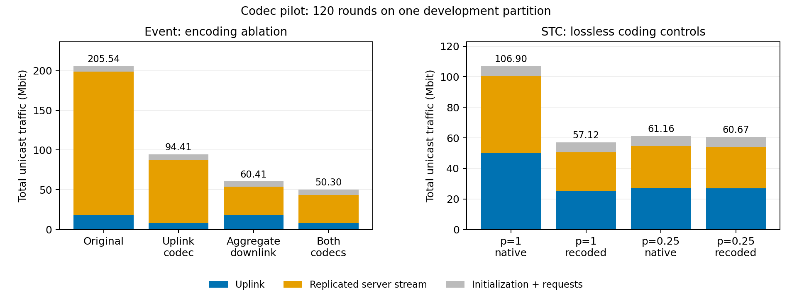

# Event message-coding pilot: results and decision

Evidence: `experiments/results/event_codec_pilot_v1/`, results commit `0c1ffe1`.
Reproduce the derived tables and checks with:

```bat
python experiments/event_codec_pilot_audit.py
```

## Decision

The first implementation gate passes. On the fixed 120-round development run,
efficient uplink positions and an exact aggregate downlink reduce Event total
unicast traffic by **75.53%**, from **205.54 to 50.30 Mbit**. The recorded model
updates remain bitwise exact. Both coding directions contribute substantially.
This establishes a useful message representation, not a convergence result.

Keep this codec as the reference for the next algorithm experiment and keep the
same lossless support codec available to STC. There is no reason to alter the
firing threshold, pulse amplitude, leak or optimizer to obtain these savings.

## Protocol and evidence audit

Three fixed points, 120 rounds each, compact CIFAR CNN with 20570 parameters,
ten fully participating clients, strong partition 4500, SGD seed 84500. Every
variant of a point uses the same underlying trajectory. All training parameters
and relevant comparator settings remain those of the archived development runs.
There is one development partition and no test-accuracy evaluation.

The pilot's source hashes and all three completion receipts verify. Recomputing
each variant's initial-model charge, requests, server-stream replication and
totals reproduces every reported traffic row. The original full-development
receipt hashes verify after restoring only their recorded LF/CRLF representation.
At every overlapping saved round (1, 60, 120), all three points exactly match
the archived 1800-round run's training objective, cross-entropy and native upload
prefix counters. The STC native server prefix counters also match exactly.
Recorded runtime and dataset fingerprints match that archive.

The run checks byte decoding and model reconstruction in flight. Full packet
streams and local NPZ checkpoints were not committed, so this analysis verifies
the saved counters/source/receipts and archived prefix consistency, rather than
independently replaying every recorded byte. Raw dataset files were not downloaded
again during analysis.

## Event ablation

All values are Mbit, including actual new-frame metadata and byte padding.
Conservative unicast charges ten copies of the server stream, the initial
float32 model and per-round requests.

| Event representation | Upload | Unicast download | Unicast total | Total reduction |
|---|---:|---:|---:|---:|
| Historical address/replay | 18.08 | 187.45 | 205.54 | 0% |
| Packed upload, replay | 7.98 | 86.43 | 94.41 | 54.07% |
| Historical upload, exact aggregate downlink | 18.08 | 42.32 | 60.41 | 70.61% |
| Packed upload and exact aggregate downlink | **7.98** | **42.32** | **50.30** | **75.53%** |



The uplink shrinks by **55.87%**. All 1200 nonempty client messages select Rice
position gaps; 1055 use exponent 4, 115 exponent 3, and the remaining 30 exponents
5--7. Encoded cost is **7.09 bits per emitted pulse**, including its frame share,
versus 16.07 previously. There are still 1200 nonempty uploads and 1125398 pulse
events. The saving comes from representation, not fewer events or client uploads.

The server stream shrinks from **18.083168 to 3.570160 Mbit**, an **80.26%**
reduction. Including initialization and requests, unicast downlink falls by
**77.42%**. The exact aggregate stream is **55.27% smaller than replaying the
already-compressed client messages**, so server aggregation contributes beyond
the uplink position code.

Summed over rounds, 1125398 input pulse events produce 644352 nonzero aggregate
coordinates with integer L1 mass 765416. The **weighted cancellation fraction
is 31.99%**. This counts the reduction in absolute pulse mass, not the fraction
of coordinates becoming silent. Aggregation also combines remaining pulses at
the same coordinate into a signed magnitude.

The selected downlink uses aggregate counts plus roundoff correction in **all
120 rounds**; the ordered-pulse fallback is never selected. It is 24.60% smaller
than that exact fallback. There are 1312 corrected coordinate-round instances,
with maximum count-times-jump discrepancy **3.73e-9**. Exactness adds only
78392 server-stream bits, or **1.56% of final total unicast traffic** after
replication. Keep the corrections in this reference implementation.

The conclusion is not driven solely by the first round. Across four consecutive
30-round windows, upload reduction ranges from 55.61% to 56.21%, and server-stream
reduction from 79.40% to 80.93%. These are descriptive windows on one trajectory,
not independent replications. Logical-broadcast total falls from **36.82 to
12.21 Mbit**, a 66.84% reduction under that different topology.

## STC coding controls

| Point | Native unicast total, Mbit | Losslessly recoded total, Mbit | Reduction |
|---|---:|---:|---:|
| STC p=1, gain 2 | 106.90 | **57.12** | **46.57%** |
| STC p=.25, gain 2 | 61.16 | **60.67** | **0.80%** |

The dense STC point benefits from omitting redundant position delimiters when
the support is full. The p=.25 point already has efficient native position coding
and gains little from the new adapter. Quantization, residuals and updates are
unchanged for both controls.

In this 120-round prefix, fully recoded Event uses **11.93% fewer bits than
recoded STC p=1**, and **17.09% fewer than recoded STC p=.25**. This is an
early-trajectory traffic comparison. It is not matched-accuracy evidence and does
not overturn the previous late-training STC results. The codec alone cannot
change either method's optimization trajectory.

## What can be said about the full archived Event run?

An exact measured full-horizon codec cost cannot be recovered from the saved
summaries because firing masks and aggregate-count distributions were not saved.
However, a **pattern-independent format ceiling** is available from the recorded
full-run event and packet counts. This is not a percentage extrapolation from
the pilot.

For a nonempty client message with k pulses, fixed Rice exponent 4 costs at most
`(d-k)/16 + 6*k` payload bits. The portfolio includes this candidate. The exact
server message is no longer than its ordered fallback with `d+2*K_round` payload
bits. Charging the current 128-bit headers and conservative byte-padding bounds
gives, for the archived 1800-round Event trajectory:

| Calculated ceiling | Mbit |
|---|---:|
| Uplink | 140.495960 |
| Server stream, before replication | 75.980480 |
| Initialization and requests | 7.159040 |
| Total with ten server-stream copies | **907.459800** |

Relative to the archived 3426.441456 Mbit, this yields a **73.52% lower bound on
traffic reduction for these formats** on that fixed trajectory, assuming the
same codec semantics. Actual aggregation may improve it further. This is a
calculated counterfactual ceiling, not measured re-encoding or proof of superiority
over a losslessly recoded full-horizon STC trajectory.

## Next scientific step

Freeze this message representation for the two-state experiment: conserve
untransmitted updates in a true residual, use a separate leaky evidence state
for timing, and retain a shared pulse quantum to preserve integer aggregation.
Use the same codec for causal comparisons with the original Event rule.

Finish the already-running STC confirmation unchanged. Its quality results and
the eventual full-horizon encoded traffic answer different questions. No new
1800-round convergence campaign is needed to close the present codec-correctness
gate. Final paper traffic claims will need actual full-horizon message accounting
or explicitly identified bounds.

To commit regenerated analysis files:

```bat
git add experiments/results/event_codec_pilot_v1
git commit -m "Refresh short Event codec pilot analysis"
git push origin main
```
