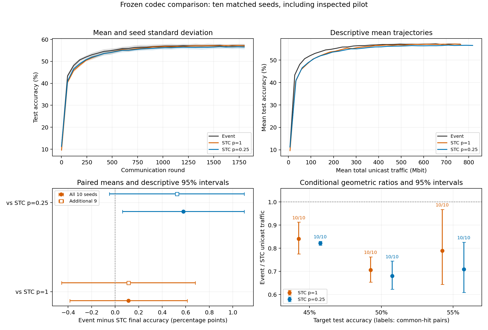

# Ten-seed codec confirmation: results and decision

Evidence: `experiments/results/event_codec_ten_seed_v1/`, results commit
`9da398d`. Ten matched partition/SGD seeds, three methods, **1800 communication
rounds**, compact CIFAR CNN (20570 parameters), ten fully participating clients,
strong label skew. The completed seed-3500 trajectories are reused; the other
27 trajectories are new. Training rules and codec settings remain frozen.

## Conclusion

The confirmation supports **lower communication to useful predictive targets**.
Relative to the tuned, losslessly recoded STC p=1 control, Event reduces the
paired geometric-mean unicast cost to 45%, 50% and 55% test accuracy by
**15.9%, 29.3% and 21.0%**. All methods reach every target on all ten seeds.
These advantages remain when the previously inspected seed 3500 is excluded.

At the fixed final horizon, Event and STC p=1 have similar observed accuracy and
total unicast cost. The primary accuracy interval includes zero; this experiment
does not establish predictive superiority or formal equivalence. Event's upload
advantage is large and consistent, while its larger downlink nearly cancels that
advantage in the final unicast total.

Preserve the codec and frozen operating points. Consolidate the paper around
communication to predictive quality, and complete the agreed core baseline
comparison using comparable lossless coding and traffic accounting. An algorithm
change is a separate research question; these results alone do not require one.

## Final predictive performance and traffic

Accuracy and CE are **mean +/- sample standard deviation across ten seeds**.
Traffic columns are arithmetic means in Mbit, using the improved representation
for every method. All figures are at the fixed round 1800.

| Method | Test accuracy, % | Test CE | Upload | Unicast download | Unicast total |
|---|---:|---:|---:|---:|---:|
| Event | 57.153 +/- 0.714 | 1.268987 +/- 0.017174 | 130.94 | 630.83 | 761.77 |
| STC p=1 | 57.039 +/- 0.636 | 1.276928 +/- 0.015125 | 378.76 | 385.76 | 764.51 |
| STC p=0.25 | 56.574 +/- 0.870 | 1.289080 +/- 0.024944 | 405.56 | 412.22 | 817.78 |

The paired Event-minus-p=1 accuracy difference is **+0.114 percentage points**
(descriptive 95% CI **[-0.385, +0.613]**). Event wins accuracy in 6/10 seeds.
The paired Event/STC total-cost geometric ratio is **0.9963**, CI
**[0.9869, 1.0059]**, corresponding to a 0.37% reduction with an interval that
includes both increased and decreased traffic. Event uses fewer final unicast
bits in 6/10 seeds. Neither endpoint establishes a clear advantage over p=1.

Against p=0.25, Event has **+0.579 percentage points** higher accuracy, CI
**[+0.061, +1.097]**, and **6.86%** lower geometric-mean final unicast traffic,
CI **[5.96%, 7.74%]**. Accuracy is higher in 8/10 seeds and traffic lower in all
ten. The nine-additional-seed accuracy difference is +0.524 points with CI
[-0.048, +1.097], so the positive accuracy finding is sensitive to including
the inspected seed. The cost advantage and lower test CE remain in that scope.

## Traffic to fixed accuracy targets

Savings use **one minus the geometric mean of within-seed Event/STC cost ratios**.
Intervals are paired, descriptive, unadjusted 95% Student-t intervals on log
ratios, transformed to percentage savings. They are secondary endpoints without
multiple-comparison correction. The uncertainty is across partition/SGD seeds
on the fixed dataset/test set, rather than across independent test datasets.

| Target test accuracy | Saving vs STC p=1 [95% CI] | Saving vs STC p=0.25 [95% CI] | Event cost wins vs each |
|---|---:|---:|---:|
| 45% | 15.86% [8.70, 22.46] | 17.82% [16.98, 18.66] | 10/10 |
| 50% | 29.33% [23.67, 34.57] | 31.89% [25.51, 37.72] | 10/10 |
| 55% | 21.04% [3.18, 35.61] | 29.02% [17.34, 39.06] | 9/10 |

All coverage counts are 10/10 for both methods, so no unreached target is dropped.
Use the first saved crossing at round 1 or a multiple of 60; do not interpolate.
These are costs to exceed a threshold at the declared observation resolution,
rather than costs to achieve exactly identical accuracies.

The advantage combines cheaper rounds and, for some targets, earlier progress.
At 45%, Event and p=0.25 first cross at round 120 in every seed, yet Event costs
less. At 50%, Event crosses by round 180 in eight seeds and by 240 in two;
p=1 crosses at 240 in all ten. At 55%, crossing rounds and costs vary more.
For partition 3800, Event needs round 900 and 371.95 Mbit, compared with p=1 at
round 600 and 259.27 Mbit: **43.46% more traffic**. It also costs 3.84% more than
p=0.25 on that seed. The average benefit is not a universal per-seed improvement.

First-crossing statistics are retrospective diagnostics. No test-driven
early-stopping policy was deployed, and some trajectories fall below a target
again after a saved crossing. The full curves and final endpoint remain relevant.

## Sensitivity to the previously inspected seed

| Quantity | All ten seeds | Nine additional seeds |
|---|---:|---:|
| Accuracy difference vs p=1, percentage points [95% CI] | +0.114 [-0.385, +0.613] | +0.113 [-0.455, +0.682] |
| Final unicast reduction vs p=1 | 0.37% | 0.37% |
| Target-45% reduction vs p=1 | 15.86% | 12.79% |
| Target-50% reduction vs p=1 | 29.33% | 28.92% |
| Target-55% reduction vs p=1 | 21.04% | 21.43% |

The pilot's favourable 45% crossing exaggerates the ten-seed average saving
at that target: the pilot saved 39.06%, while the additional-nine mean saving
is 12.79%. The advantage still remains, with a nine-seed interval
[11.79%, 13.77%]. At 55%, the additional-nine interval is much wider,
[0.91%, 37.71%]. These secondary intervals should be interpreted descriptively.



## Communication direction and coding gain

Relative to recoded p=1, Event has **65.43% fewer upload bits** (CI
[65.09%, 65.77%]) and **63.52% more unicast download bits** (CI
[61.98%, 65.08%]). Both directions hold in every seed. Under the separate
logical-broadcast accounting model, Event has **53.52% lower total traffic**
(CI [53.07%, 53.97%]). Arithmetic mean broadcast totals are 193.97 Mbit for
Event, 417.28 for p=1, and 446.73 for p=0.25. This model charges one common
server message once and does not measure physical multicast, latency or energy.

Comparing the arithmetic mean old/new unicast totals within each method:

| Method | Original encoding, Mbit | Improved encoding, Mbit | Reduction |
|---|---:|---:|---:|
| Event | 3362.96 | 761.77 | 77.35% |
| STC p=1 | 1511.38 | 764.51 | 49.42% |
| STC p=0.25 | 825.14 | 817.78 | 0.89% |

The STC full-support position bypass is substantial. Comparing improved Event
only against native STC framing would confound the training algorithm and
lossless representation. Codecs preserve each method's updates; they do not
cause an improvement in predictive accuracy within that method.

Event chooses aggregate-counts-plus-corrections downlinks in all **18000**
seed/round instances; no ordered fallback is selected. Correction overhead is
1.55--1.65% of final total unicast traffic across seeds, with maximum canonical
roundoff 3.73e-9. Late-window savings remain: across rounds 1201--1800, mean
upload reduction is 57.77% and mean server-stream reduction 79.86% relative to
legacy Event framing. Keep the exact corrections and present codec gain as a
communication result.

## Regularized objective

Mean training objectives are 1.397003 for Event and 0.990651 for p=1, but mean
training cross-entropies are 0.926459 and 0.932903. The mean L2 penalties are
0.470544 and 0.057749, with inferred mean parameter norms 43.38 and 15.20.
The L2-penalty gap is slightly larger than the objective gap because Event has
lower mean training CE. STC remains better on the stated regularized objective;
the objective difference does not imply a similarly large prediction deficit.

## Audit, limits and next decision

The independent audit verifies **30 receipts** (three reused and 27 new),
**54000 round records**, **930 evaluated model checkpoints**, complete sample
coverage and source/data/runtime identities. It reproduces all eight saved
analysis CSVs, including paired statistics and target coverage. Small
cross-runtime t-quantile differences are below 2e-11 percentage points and have
no effect at the reported precision; original analysis files are retained.

All ten archived Event curve/traffic regression checks are independently
repeatable. The committed local audit reports matches to all twenty native
STC confirmation curves. Those separate confirmation files are absent from
this push, so the independent audit records their absence while verifying
every new STC trajectory's own receipt and saved evidence. Full packets,
NPZ models, per-example predictions and raw images were not reloaded. Live
decoding and client-model equality checks belong to the frozen execution code.

This is a completed confirmation for one compact model and federation regime,
with fixed STC operating points and common lossless coding opportunities.
It supports a scoped accuracy-per-bit contribution. Field-wide state of the art,
formal equivalence, and larger-model or partial-participation claims require
their own evidence. The next paper task is consolidation with the agreed dense
FedAvg, STC, Ström-style residual-pulse and EF-TopK baselines and comparable
message accounting. Preserve the threshold/quantum and full-horizon choices
while completing that comparison.

Reproduce this audit without training or overwriting the local analysis:

```bat
python experiments/event_codec_ten_seed_audit.py
git add experiments/results/event_codec_ten_seed_v1
git commit -m "Refresh ten-seed codec evidence audit"
git push origin main
```
