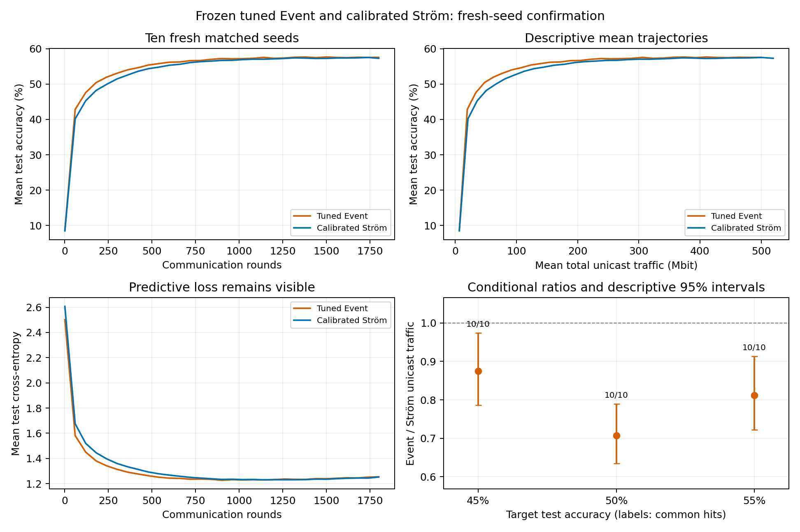

# Fresh tuned Event versus calibrated Ström: results and decision

Evidence: `experiments/results/event_strom_fresh_confirmation_v1/`, results
commit `220f0842abf1268c0ba6c20bfa4e506b6e0ab500`.
Twenty new full-training trajectories use ten fresh matched partition seeds
6000–6900 and SGD seeds 86000–86900. Both methods use the compact CIFAR CNN
(20570 parameters), ten fully participating clients, strong 55%-dominant label
skew, 50000 training images, the same 10000-image official test set, and
**1800 communication rounds**. No development checkpoint or previous training
trajectory is reused. Event freezes threshold **0.05**, initial quantum **0.01**;
Ström freezes threshold **0.05**, native gain **0.10**. Both retain their native
pulse rules and share the improved lossless communication representation.

## Conclusion

**Tuned Event has a reproducible communication advantage over calibrated
Ström in this setup, especially during early predictive learning.** It uses
**3.91% fewer final unicast bits**, descriptive paired 95% interval
**[3.01%, 4.79%]**, with lower cost in every seed. Communication to 50% test
accuracy is **29.23% lower [21.01%, 36.58%]**, also in every seed. Both methods
reach every declared accuracy target in all ten runs.

The primary predictive endpoint does not establish a final-accuracy advantage:
Event minus Ström is **+0.267 percentage points [-0.435, +0.969]**. Final test
CE differs by **+0.001703 [-0.015934, +0.019339]**. Report these paired
uncertainties alongside the communication result; they do not establish formal
accuracy equivalence or noninferiority.

The strongest empirical contribution is **lower communication to useful
predictive accuracy relative to a calibrated residual-pulse comparator under
conservative unicast accounting**. This supports a sharper numerical argument
than rounds alone. It remains an empirical result on this dataset/model/client
regime; it is not a proof of faster mathematical convergence or measured
wall-clock acceleration.

## Final predictive quality and communication

Accuracy and CE are mean +/- sample standard deviation over ten seeds. Traffic
is the arithmetic mean in Mbit. Both methods use `both_codecs`; unicast includes
initialization, frame headers/padding, requests and replication to each client.

| Method | Test accuracy, % | Test CE | Upload | Download | Total unicast |
|---|---:|---:|---:|---:|---:|
| Tuned Event | 57.546 +/- 0.490 | 1.254556 +/- 0.013995 | 73.44 | 426.00 | 499.44 |
| Calibrated Ström | 57.279 +/- 0.659 | 1.252853 +/- 0.016318 | 77.68 | 442.07 | 519.75 |

Event has higher final accuracy in **7/10** pairs; each method has lower final
CE in **5/10**. The per-pair accuracy difference ranges from -1.86 to +1.46
percentage points. Keep the unfavourable partitions: on partition 6800, Event
finishes at lower accuracy and higher CE despite using fewer bits.

Traffic reductions below summarize within-seed Event/Ström ratios geometrically,
then transform the ratio as `100 * (1 - ratio)`. They are distinct from taking
the ratio of arithmetic-mean costs.

| Accounting | Event reduction [descriptive 95% interval] | Event cost wins |
|---|---:|---:|
| Upload | 5.45% [4.50%, 6.39%] | 10/10 |
| Unicast download | 3.63% [2.75%, 4.51%] | 10/10 |
| Total unicast | 3.91% [3.01%, 4.79%] | 10/10 |
| Logical-broadcast total | 4.79% [3.87%, 5.71%] | 10/10 |

Logical-broadcast arithmetic means are 115.98 Mbit for Event and 121.83 Mbit
for Ström. The advantage therefore does not depend on promoting logical
broadcast to the primary accounting model. Download remains about 85% of each
method's total unicast cost. The modest final saving is useful, but should not
be described as a large reduction in the cost of running all 1800 rounds.

## Communication to predictive accuracy

Targets were fixed before confirmation at 45%, 50% and 55% test accuracy.
Crossings use the first saved evaluation at round 1 or a multiple of 60, with
no interpolation. All target intervals have ten common hits, so no seed is
removed by conditional target-cost analysis.

| Target | Mean rounds, Event / Ström | Mean unicast Mbit, Event / Ström | Event traffic reduction [95% interval] | Event fewer rounds / ties / more | Event fewer bits |
|---|---:|---:|---:|---:|---:|
| At least 45% | 120 / 132 | 33.57 / 38.68 | 12.53% [2.62%, 21.42%] | 2 / 8 / 0 | 10/10 |
| At least 50% | 198 / 270 | 51.94 / 73.32 | 29.23% [21.01%, 36.58%] | 9 / 1 / 0 | 10/10 |
| At least 55% | 498 / 582 | 128.14 / 156.39 | 18.79% [8.70%, 27.76%] | 7 / 1 / 2 | 8/10 |

The 50% result combines fewer rounds in nine pairs with cheaper communication
in all ten. At 45%, most pairs cross at the same saved round, while Event still
uses fewer bits. At 55%, partitions 6700 and 6800 favour Ström: Event crosses
60 rounds later and costs 3.46% and 4.87% more, respectively. This prevents a
universal faster-progress or lower-target-cost claim across individual seeds.

Crossing accuracies can overshoot a target and later fall below it. Saved
crossings are retrospective diagnostics, not implemented test-driven stopping.
Mean trajectories are descriptive; the per-seed crossing table defines the
target-cost comparison.



## Representation and training diagnostics

Event emits a mean **9.06 million** coordinate pulses per run, versus **9.71
million** for Ström. Mean firing fractions in the last 120 rounds are **2.68%**
and **2.93%**. Counts-plus-float32-corrections is selected in all **18000
method/round instances per method**, with no ordered fallback. Mean exact
correction overhead is **4.36 Mbit (0.87%)** for Event and **7.61 Mbit (1.46%)**
for Ström. These are diagnostics of the observed traffic gap, not an ablation
isolating a causal effect of leak, reset, threshold or quantum.

On the unchanged trajectories, mean legacy-to-improved unicast costs are
1614.40 to 499.44 Mbit for Event and 1729.64 to 519.75 Mbit for Ström. Shared
encoding is valuable for both methods and is not an exclusive Event mechanism.
The fresh study does not contain the old Event setting, so it does not provide
a paired estimate of the effect of changing Event's threshold/quantum. The
earlier development comparison supplies that separate validation evidence.

Mean regularized training diagnostics are **1.187239** for Event and
**1.153873** for Ström. Their training CEs are **0.924106** and **0.957751**;
L2 penalties are **0.263134** and **0.196122**. Event has lower training CE but
a larger penalty and objective. Mean inferred parameter norms are 32.43 and
27.95. Consequently, the predictive target-cost result should not be presented
as better minimization of the common regularized training objective. These
diagnostics use the same fixed-size 5000-image training subset.

## Verification and scope

The saved-evidence audit validates the frozen development selection, current
source fingerprints, all **20 complete fresh receipts**, **36000 round records**
and **620 sampled model fingerprints**. It reproduces all eight original
analysis CSVs, independently reconstructs every traffic prefix/endpoint from
round counters, and independently recomputes paired intervals and target
coverage. All ten fresh pairs remain included. The twelve original analysis
tables/audits/figures are preserved, including the Windows-generated plot files.

The audit reads saved evidence; it does not reload raw images, packet bytes or
NPZ model weights. Execution-time codec fidelity/model equality remains part of
the frozen runner's checks. Statistical comparisons allow tiny cross-runtime
SciPy quantile differences. Intervals are descriptive and unadjusted for
multiple comparisons, covering partition/SGD variation on one fixed previously
inspected official test set. Fresh seeds do not create a blind new test dataset.

## Paper decision and next step

Freeze both selected operating points and close their calibration/confirmation
chain. The fresh results support a concrete claim: **Event reduces unicast
communication to the declared predictive targets on average, while final
accuracy and CE differences remain unresolved at the precision of ten pairs**.
The final 3.91% cost saving is a secondary strength; early target efficiency is
the clearer distinction. Keep final accuracy and CE visible so the argument
does not depend on choosing favourable intermediate snapshots.

Complete the final common-protocol numerical core by adding Dense FedAvg, STC
and EF-TopK on these same ten partition/SGD pairs with their frozen or separately
validation-selected settings and common accounting. The older STC/other-method
results use different seed grids; do not merge their rows into the fresh table
as if they were paired controls. Preserve the calibrated Ström setting and use
the shared encoder wherever the comparator protocol permits it. A broad
communication-superiority or state-of-the-art claim still requires that core
comparison and evidence beyond this one compact-CNN/full-participation regime.

Reproduce this audit without training or modifying the original analysis:

```bat
python experiments/event_strom_fresh_confirmation_audit.py
git add experiments/results/event_strom_fresh_confirmation_v1
git commit -m "Refresh fresh Event and Strom confirmation evidence audit"
git push origin main
```
