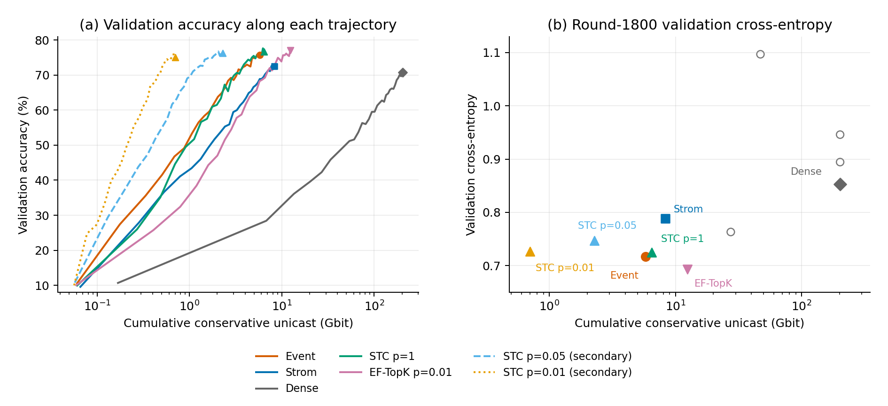

# ResNet-14 baseline calibration: results and next comparison

Evidence: `experiments/results/resnet14_baseline_development_v1/`, user-results
commit `1eb535792cc882d9d1da910e5e4bb5863935426b`. Protocol:
[`RESNET14_BASELINE_DEVELOPMENT.md`](RESNET14_BASELINE_DEVELOPMENT.md).

## Scientific decision

**The calibrated baselines change the interpretation of the ResNet result.**
Event remains better than calibrated Ström and Dense on this development
split. EF-TopK achieves the lowest validation cross-entropy and the highest
validation accuracy, at higher communication cost. The selected STC p=1
setting has higher accuracy than Event, slightly worse CE, and slightly
higher total unicast cost. Importantly, the two sparse STC finalists offer
much cheaper communication with similar or higher accuracy.

Keep the predeclared CE-selected primary settings frozen. Do not replace
them after inspecting accuracy or communication. Nevertheless, a comparison
only against the selected p=1 STC point would conceal an important
communication-quality tradeoff. Include both sparse STC finalists explicitly
in the next confirmation as declared secondary operating points. These are
already evaluated configurations, not a new tuning search.

**Event is on the observed CE-versus-cost frontier, but is dominated on the
final accuracy-versus-cost frontier by STC p=0.05 in this one development
run.** Thus these data do not support a general claim that Event needs fewer
bits to achieve the same predictive accuracy than calibrated STC. They also
do not establish a test-performance ranking: no new official-test evaluations
were performed in this calibration.

## Protocol, completion and evidence checks

Use the same CIFAR-10 ResNet-14 with GroupNorm, 175258 parameters, ten fully
participating clients and strong 55%-dominant label skew as the pulse study.
The shared development protocol is 45000 training / 5000 balanced validation
images, partition seed 7000, split seed 17000, SGD seed 97000, initialization
7777, five local SGD steps, batch 32, learning rate 0.05 and L2 coefficient
0.0005. These common learning parameters remain fixed across methods.

All **54 screens and nine finalists completed**, with zero numerical failures.
Every 600-round screen used its 1800-round configuration from the start;
each finalist continued the exact same trajectory to round 1800. The three
lowest round-600 validation-CE points per family were promoted. Final choices
minimize round-1800 validation CE among those three, with total unicast bits
and point ID as tie breakers.

The campaign used **43200 unique training rounds and 774 unique evaluation
points**, or 14400 unique rounds per baseline. The archives contain 48600
round rows and 873 sampled model fingerprints because full finalist files
repeat nine screen prefixes. This matches the accumulated screen/continuation
budget per Event/Ström family, while their historical search order and grid
geometry differ. Equal work is not proof of equal tuning efficacy or global
optimality. In particular, both selected STC and EF gains are at the upper
grid boundary, four; no boundary extension is inferred or launched.

The independent audit verifies the frozen 66-source contract, all 63 complete
receipts and their CSV hashes, all nine exact continuation prefixes, independent
promotion/final rankings, per-round frame constraints, and every saved traffic
prefix and endpoint. It reproduces all four original analysis CSVs and the
original coverage JSON. The two Event/Ström development controls also pass
receipt, model-fingerprint and independent traffic checks. All **323 original
campaign files and ten pulse-control evidence files** remain byte-for-byte
unchanged. The audit loads saved validation evidence only; no training,
images, development checkpoints or saved test metrics are required.

These are checks of recorded metrics, counters, identities and consistency.
Raw packet/model arrays are not archived here, so the audit does not replay
training or independently recompute predictions. Native/encoded parity was
checked by the implementation's unit and synthetic ResNet verification.

## Frozen primary choices

All endpoints below are at round 1800 on the **same validation split**.
Traffic is complete conservative bidirectional unicast, including actual
encoded frames, initialization, requests and recipient replication.
**1 Gbit = 10^9 bits.** No intervals are reported from a single calibration seed.

| Method | Frozen setting | Validation CE | Validation accuracy | Uplink, Gbit | Downlink, Gbit | Total, Gbit |
|---|---|---:|---:|---:|---:|---:|
| Event | threshold 0.01, initial quantum 0.0025, gain 1 | 0.717497 | 75.78% | 0.951 | 4.837 | 5.788 |
| Ström | threshold 0.005, FedAvg-equivalent gain 2 | 0.788567 | 72.50% | 1.816 | 6.467 | 8.283 |
| Dense FedAvg | constant gain 1.5 | 0.853010 | 70.78% | 100.950 | 101.006 | 201.956 |
| STC | upload/download p=1, gain 4 | 0.724973 | 76.70% | 3.203 | 3.252 | 6.455 |
| EF-TopK | global p=0.01, gain 4 | 0.693610 | 77.12% | 1.304 | 11.081 | 12.385 |

Event's final unicast saving is **30.12% versus Ström**, **97.13% versus
Dense**, **10.33% versus selected STC** and **53.26% versus EF-TopK**. The
quality differences must accompany those numbers. Event has 3.28 pp higher
accuracy than Ström and 5.00 pp higher than Dense, but 0.92 pp lower than STC
and 1.34 pp lower than EF. Its CE is 0.007476 lower than selected STC, but
0.023887 higher than EF. Higher accuracy and lower CE need not rank models
identically: CE also depends on the probabilities assigned to predictions.

These development numbers must not be mixed with the previously confirmed
ten-seed test means (Event 75.465%, Ström 72.157%). The
[`completed ten-pair Event/Ström conclusion`](RESNET14_TEN_SEED_RESULTS.md)
remains unchanged; the other methods have not yet received matching test
confirmation.

## All finalists, including sparse STC

| Family | Finalist | Screen CE rank within family | Final validation CE | Final accuracy | Total unicast, Gbit |
|---|---|---:|---:|---:|---:|
| Dense | gain 1.5, exponent 0 (selected) | 1 | 0.853010 | 70.78% | 201.956 |
| Dense | gain 2, exponent 0.2 | 2 | 0.894400 | 68.30% | 201.956 |
| Dense | gain 2, exponent 0.3 | 3 | 0.945923 | 66.12% | 201.956 |
| STC | p=0.05, gain 4 | 1 | 0.747501 | 76.30% | 2.277 |
| STC | p=1, gain 4 (selected) | 2 | 0.724973 | 76.70% | 6.455 |
| STC | p=0.01, gain 4 | 3 | 0.727053 | 75.04% | 0.700 |
| EF-TopK | p=0.05, gain 4 | 1 | 1.096719 | 66.66% | 47.172 |
| EF-TopK | p=0.025, gain 4 | 2 | 0.763224 | 76.22% | 27.447 |
| EF-TopK | p=0.01, gain 4 (selected) | 3 | 0.693610 | 77.12% | 12.385 |

STC p=0.05 uses **60.66% fewer final bits than Event** and attains **0.52 pp
higher accuracy**, while its CE is 0.030004 worse. STC p=0.01 uses **87.91%
fewer bits**, with accuracy **0.74 pp lower** and CE **0.009556 worse** than
Event. The final CE margin between selected STC p=1 and p=0.01 is only
**0.0020795**. That observed margin selects p=1 under the frozen rule; it
does not establish a reproducible predictive advantage over p=0.01.

Within these eleven observed endpoints, the CE/cost frontier consists of STC
p=0.01, Event and EF-TopK p=0.01. The accuracy/cost frontier consists of STC
p=0.01, STC p=0.05, STC p=1 and EF-TopK p=0.01. These are two separate
descriptive frontiers, not a population-level dominance result. No significance
or equivalence claim follows from this one split.

The EF ranking reverses between screen and final horizon: the 5% point was
best at round 600 but worst of its three finalists at round 1800. This
illustrates the conditional nature of the screen-and-continue design. The
selected point is best among the promoted finalists, not among all 18 points
trained to 1800 rounds. No missing long-horizon outcomes are inferred.



Solid trajectories show the frozen primary settings; dashed/dotted curves
show the two sparse STC finalists. The final CE panel includes all eleven
endpoints; hollow circles are the remaining Dense/EF finalists. Lines connect
saved evaluations, without imposing monotonicity. These are development
curves, not new test evidence.

## Communication to validation accuracy targets

The project already used 45%, 50% and 55% as communication-to-quality
diagnostics. The audit also reports **exploratory 65%, 70% and 75% targets
added after inspecting these results**, with that role recorded in every row.
The following table shows one existing target and two higher exploratory
targets. Each cell is **first saved round / cumulative unicast Gbit**.

| Setting | 50% validation accuracy | 70% (exploratory) | 75% (exploratory) |
|---|---:|---:|---:|
| Event | 360 / 1.064 | 1080 / 3.398 | 1500 / 4.775 |
| Ström | 420 / 1.868 | 1440 / 6.601 | Not reached by 1800 |
| Dense gain 1.5 | 480 / 53.896 | 1680 / 188.496 | Not reached by 1800 |
| STC p=1, gain 4 | 300 / 1.123 | 900 / 3.257 | 1320 / 4.750 |
| STC p=0.05, gain 4 | 300 / 0.427 | 840 / 1.093 | 1320 / 1.685 |
| STC p=0.01, gain 4 | 480 / 0.228 | 1140 / 0.464 | 1680 / 0.657 |
| EF-TopK p=0.01, gain 4 | 360 / 2.417 | 1020 / 6.985 | 1500 / 10.310 |

Sparse STC has a lower observed communication cost than Event at each of
these three targets. STC p=0.05 also reaches them in fewer saved rounds.
STC p=0.01 reaches them later than Event, while using much less traffic.
Even selected STC p=1 reaches 70% and 75% at slightly fewer bits and in fewer
rounds here. A final 1800-round traffic saving against p=1 does not imply a
traffic saving at every quality target.

Crossings use the first saved evaluation, without interpolation or requiring
later accuracy to remain above the target. All runs continued to 1800. Censored
targets stay in the output. These diagnostics do not establish asymptotic
convergence rates or physical latency/energy savings.

## What the traffic decomposition tells us

Event's downlink is **83.57%** of its final unicast cost; EF's is **89.47%**.
Event uses its exact counts-plus-patch aggregate representation in all 1800
rounds. EF chooses lossless support-coded aggregate downlink in all rounds
of the selected run; ordered replay is never cheaper. Thus the EF result
already benefits from the shared exact aggregate/replay portfolio.

STC compresses the server aggregate again with its own ternary operator and
server error feedback, whereas Event's current downlink preserves the native
pulse aggregate exactly. At p=0.05 the measured STC downlink is **1.162 Gbit**,
versus Event's **4.837 Gbit**, while their uplinks are **1.115 versus 0.951
Gbit**. The observed cost disadvantage of Event at this operating point is
in the downlink. At p=0.01 STC reduces both directions (0.322 Gbit up / 0.377
Gbit down). STC p=1 still ternarizes tensor magnitudes; it is not Dense FedAvg.

This identifies a concrete protocol difference to investigate if another
method-development stage is justified. It does not show that adding server
quantization to Event would preserve its current dynamics or improve quality.
Any such variant requires a separate protocol and validation study after
the present comparison is frozen.

## Recommended next experiment

1. **Keep the primary five-method comparison:** run the three CE-selected
   baselines on the same ten partition seeds 7100--8000 / SGD seeds
   97100--98000; reuse the twenty completed Event/Ström outcomes unchanged.
   This requires **30 new full-training runs / 54000 rounds**.
2. **Declare both sparse STC points as secondary before confirmation:** p=0.05
   and p=0.01, both gain 4 and symmetric upload/download fractions. Run each
   on the same ten seeds. This adds **20 runs / 36000 rounds**, not a new
   search. Their roles remain explicitly exploratory choices from development
   evidence; they do not replace the frozen p=1 primary winner.
3. Refit each new run from initialization on all 50000 training images; do
   not reuse development checkpoints. Evaluate the same official test set at
   round 1/every 60 and the fixed round-1800 endpoint. Report accuracy, CE,
   complete upload/download/unicast cost, target coverage and paired effects.
   Keep all outcomes and avoid test-driven retuning or early stopping.

The recommended expanded confirmation therefore requires **50 new runs /
90000 rounds** and yields 70 outcomes including twenty existing pulse runs.
It preserves the frozen primary panel while answering the sparse-STC challenge
to the paper's communication-efficiency claim. The test dataset has already
been inspected for Event/Ström; common-seed comparison reduces nuisance
variation but does not create a new blind external benchmark.

No confirmation training or retuning was launched in this analysis. The paper
should retain its confirmed Event-versus-Ström claim and wait for this
comparison before asserting an advantage over tuned STC/EF on ResNet.

## Reproduce this analysis

From the research repository, with its normal NumPy/pandas/matplotlib analysis
dependencies, no CIFAR download or Torch runtime is needed:

```bat
python experiments\resnet14_baseline_development_audit.py
git add experiments/results/resnet14_baseline_development_v1
git commit -m "Refresh ResNet14 baseline calibration evidence audit"
git push origin main
```

The command writes supplementary `analysis_*` files and PNG/PDF figures. It
checks that original CSVs, JSONs and pulse-control evidence remain unchanged.
The script, this report and figures are committed alongside the audit outputs.
