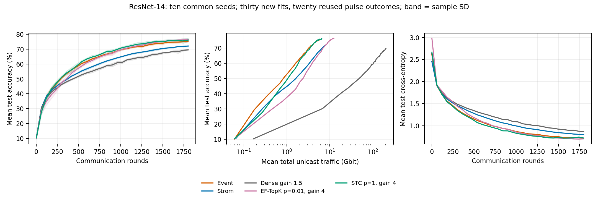

# Selected ResNet-14 common-seed confirmation: results and paper decision

Evidence: `experiments/results/resnet14_core_confirmation_v1/`, user-results
commit `49b57fb6012b6c80577604fdcc05a0322409498e`. Protocol:
[`RESNET14_CORE_CONFIRMATION.md`](RESNET14_CORE_CONFIRMATION.md).
All **thirty new fits and twenty verified pulse reuses** are complete.

## Scientific conclusion

**The completed panel supports lower communication to the declared predictive
accuracy targets for Event, with a final quality/communication tradeoff against
the selected STC and EF-TopK configurations.** Event has fewer final unicast
bits in 10/10 pairs against every comparator and higher final accuracy in
10/10 pairs against Dense and Ström. It does not have the highest final mean
accuracy: EF-TopK and STC p=1/gain 4 are higher.

Against selected STC, Event saves **23.43% [20.33%, 26.40%]** of unicast traffic
to 50% accuracy and **10.96% [10.61%, 11.31%]** at round 1800. Its final mean
accuracy is **0.724 percentage points lower**, with paired interval
**[-1.611, +0.163] pp**. This difference is unresolved under the descriptive
interval, which does not establish equivalence or noninferiority. Final CE
also has an unresolved difference.

Against EF-TopK, Event saves **53.57% [53.39%, 53.75%]** of final unicast
traffic while its mean accuracy is **0.943 pp lower [-1.575, -0.311]**. This
is a measured quality/cost tradeoff, not dominance of EF. Event retains the
previously confirmed stronger result over Ström: **+3.308 pp** final accuracy
and **30.74%** lower final unicast cost.

**Freeze this agreed five-method panel.** The next step is manuscript
consolidation around communication to predictive quality, with the selected
operating points identified explicitly. No additional training, tuning or
sparse-STC confirmation is launched or recommended by default here.

## Fixed protocol and verification

Use CIFAR-10, Torch ResNet-14/GroupNorm (**175258 parameters**), ten fully
participating clients and strong 55%-dominant label skew. All methods share
five local SGD steps, batch 32, learning rate 0.05, L2 coefficient 0.0005,
initialization 7777, full 50000-image training, a 5000-image training diagnostic
subset per seed and the fixed official 10000-image test set. Evaluate at round
1 and every 60 rounds; the predictive endpoint is the fixed round 1800.

Partition seeds are **7100--8000 in increments of 100**, paired with SGD seeds
**97100--98000**. Development checkpoints and the 45000/5000 development split
do not initialize or replace these full-training fits. Configurations remain:

| Method | Frozen setting | Outcome origin |
|---|---|---|
| Event | Threshold 0.01, initial quantum 0.0025, quantum exponent 0.2, leak 0.999, gain 1 | Ten read-only reuses |
| Ström | Threshold 0.005, native gain 0.10 / FedAvg-equivalent gain 2 | Ten read-only reuses |
| Dense | Constant server gain 1.5 | Ten new fits |
| EF-TopK | Global retained fraction 0.01, gain 4 | Ten new fits |
| STC | Upload/download fractions 1, gain 4 | Ten new fits |

Here "Ström" denotes the Ström-style residual-pulse adaptation within the
common round-based FedAvg host.

The three added baselines are the frozen validation-CE winners of their
bounded ResNet screen/continuation studies. Their settings are not selected
from these test outcomes. The new fits use the byte-equivalent accelerated
CPU codec; the recorded Windows/RTX 4090 environment, Torch 2.5.1, NumPy 1.26.4,
four threads and evaluation batch 256 match the pulse protocol. Mixed
precision and TF32 remain disabled.

The independent audit verifies the **71-source contract**, frozen choices,
all 30 complete new receipts, all 20 exact reuse receipts, full-training
manifests, frame constraints and every saved cumulative traffic prefix and
endpoint. Coverage is **90000 round records, 1550 sampled model fingerprints
and 50 distinct final models**. It reproduces all **seven original analysis
CSVs**, the original completion/coverage JSONs and the completed Event/Ström
endpoint and target contrasts. All **192 original campaign files and 116
read-only pulse source files** remain byte-for-byte unchanged.

The audit reads saved metrics, counters and identities without Torch, images,
packet/model arrays or training replay. Execution-time encoding/decoding and
client-model reconstruction belong to the frozen runners; native/original/
accelerated parity and exact resume were checked synthetically before execution.

## Final quality and communication

Accuracy and CE are arithmetic mean +/- sample SD across ten paired seeds.
Traffic columns are arithmetic means. **1 Gbit = 10^9 bits.** Primary cost is
complete bidirectional conservative unicast: actual encoded frames/padding,
initial synchronization, per-client requests and recipient replication.

| Method | Test accuracy, % | Test CE | Uplink, Gbit | Downlink, Gbit | Total unicast, Gbit |
|---|---:|---:|---:|---:|---:|
| Event | 75.465 +/- 0.571 | 0.717770 +/- 0.016524 | 0.944 | 4.808 | 5.752 |
| Ström | 72.157 +/- 0.517 | 0.799113 +/- 0.014260 | 1.823 | 6.482 | 8.305 |
| Dense gain 1.5 | 69.586 +/- 0.542 | 0.867355 +/- 0.016234 | 100.950 | 101.006 | 201.956 |
| EF-TopK p=0.01, gain 4 | 76.408 +/- 0.872 | 0.701663 +/- 0.019545 | 1.304 | 11.086 | 12.389 |
| STC p=1, gain 4 | 76.189 +/- 1.182 | 0.719875 +/- 0.036201 | 3.208 | 3.252 | 6.460 |

Paired effects below use Event minus the reference for quality and
`100*(1-geometric_mean(Event/reference))` for communication. Intervals are
**descriptive, unadjusted paired 95% Student-t intervals**, with ratios on
the log scale. They are not confidence intervals across independent datasets.

| Reference | Event accuracy difference, pp [95% interval] | Event CE difference [95% interval] | Event final unicast saving [95% interval] |
|---|---:|---:|---:|
| Ström | +3.308 [+2.835, +3.781] | -0.081343 [-0.096304, -0.066382] | 30.74% [30.46%, 31.01%] |
| Dense | +5.879 [+5.394, +6.364] | -0.149585 [-0.167096, -0.132073] | 97.15% [97.14%, 97.16%] |
| EF-TopK | -0.943 [-1.575, -0.311] | +0.016107 [-0.001711, +0.033924] | 53.57% [53.39%, 53.75%] |
| STC | -0.724 [-1.611, +0.163] | -0.002105 [-0.032119, +0.027909] | 10.96% [10.61%, 11.31%] |

Event has higher accuracy in **10/10** pairs against Dense and Ström,
**2/10** against EF and **3/10** against STC. It has lower CE in 10/10 versus
Dense and Ström, 3/10 versus EF and 5/10 versus STC. Final traffic is lower
in **10/10 against every reference**. Against STC, individual accuracy
differences range from -2.69 to +0.97 pp; the zero-containing interval must
not be described as demonstrated identical accuracy. EF's mean CE is lower,
but its paired CE interval includes zero; accuracy and CE need not rank
methods with the same certainty.

Mean worst-class accuracy is 54.61% for Event, 47.54% for Ström, 45.93% for
Dense, 54.82% for EF and 52.15% for STC. These secondary class diagnostics
do not reverse the main overall-accuracy interpretation.

## Traffic to the declared accuracy targets

Every method reaches **45%, 50% and 55% test accuracy in 10/10 runs**. All
150 method/seed/target outcomes are retained, with no censored target in
this completed data. The implementation continues to preserve censoring for
unreached targets; no missing achievement is assigned a free or zero cost.

| Reference | Event saving to 45% [95% interval] | Event saving to 50% [95% interval] | Event saving to 55% [95% interval] |
|---|---:|---:|---:|
| Ström | 37.23% [32.68%, 41.47%] | 51.44% [48.74%, 54.00%] | 47.54% [44.24%, 50.64%] |
| Dense | 97.81% [97.62%, 97.99%] | 98.30% [98.21%, 98.39%] | 98.24% [98.12%, 98.35%] |
| EF-TopK | 63.27% [60.03%, 66.25%] | 65.39% [62.50%, 68.06%] | 58.41% [55.37%, 61.25%] |
| STC | 22.52% [18.12%, 26.67%] | 23.43% [20.33%, 26.40%] | 15.01% [8.89%, 20.71%] |

At the 50% target, the arithmetic-mean crossing costs and rounds are:

| Method | Mean first saved round | Mean total unicast, Gbit | Coverage |
|---|---:|---:|---:|
| Event | 306 | 0.893 | 10/10 |
| Ström | 414 | 1.837 | 10/10 |
| Dense | 468 | 52.550 | 10/10 |
| EF-TopK | 384 | 2.582 | 10/10 |
| STC | 312 | 1.167 | 10/10 |

Event uses fewer bits at 45% and 50% in **10/10 pairs against every reference**.
At 55%, it has fewer bits in 10/10 against Dense, Ström and EF, and **9/10
against STC**. The positive average savings do not imply a win on every seed
or at every possible accuracy level.

The STC comparison is particularly important for the convergence wording:

| Target | Mean Event / STC first saved round | Event earlier / tied / later |
|---|---:|---:|
| 45% | 252 / 246 | 0 / 9 / 1 |
| 50% | 306 / 312 | 1 / 9 / 0 |
| 55% | 438 / 420 | 0 / 8 / 2 |

At 50%, nine pairs cross on the same sampled round. The communication saving
therefore predominantly reflects cheaper messages rather than fewer rounds.
At 45% and 55%, STC is earlier on average while Event still has lower average
target cost. A general claim of faster convergence than selected STC would
misrepresent this result.

Targets were fixed before confirmation. First crossings are saved observations
at round 1/every 60, without interpolation or a requirement that later accuracy
stay above the target. All fits continue to 1800. These mid-training targets
do not establish minimum traffic at all higher accuracies, asymptotic rates,
physical network latency or energy savings.



Bands in the accuracy-versus-round panel are sample SD, not confidence bands.
The accuracy-versus-cost panel connects mean accuracies at mean cumulative
costs; it does not define the within-seed first-crossing estimator above.
The original diagnostic PNG/PDF are preserved unchanged.

## Directional communication and optimization diagnostics

Against STC, Event uploads **70.56% [70.41%, 70.71%] fewer bits**, but its
unicast downlink is **47.83% [47.30%, 48.37%] larger**. This leaves the
10.96% total unicast saving. Event does not save in both directions against
STC. It saves upload and download against Dense, Ström and EF.

Logical-broadcast mean totals are 1.425 Gbit for Event, 2.471 for Ström,
111.050 for Dense, 2.412 for EF and 3.533 for STC. Event's paired logical-
broadcast saving against STC is 59.67% [59.48%, 59.85%]. This supplementary
model charges one server stream once. It is not the headline accounting and
does not measure a deployed multicast service.

Event uses exact counts-plus-patch aggregate downlink in all **18000**
seed/round instances. Ström uses that representation in 17970 and ordered
replay in 30. EF chooses its exact lossless support-coded aggregate in all
18000 instances, with no ordered-replay selection. STC retains its native
server ternarization and error feedback; its p=1 message is ternary, not Dense.
The costs do not compare Event-only coding with uncoded baseline frames.

Mean training CE / regularized objective are 0.444459 / 0.830630 for Event,
0.643012 / 1.206238 for Ström, 0.758816 / 1.046813 for Dense, 0.393125 /
0.626969 for EF and 0.370607 / 0.614937 for STC. Event's parameter norm is
39.302 versus 30.584 for EF and 31.262 for STC. These data do not establish
superior minimization of the common regularized training objective or isolate
leak, reset or quantum scheduling as a causal generalization mechanism.

## Computational efficiency of the faster runner

The completed runs used backend `EVS1_bound1_packbits_regex_v1`, with its
sources pinned in the verified contract. Pooled median recorded codec times
over the ten new fits are:

| Method | Earlier selected validation run, original codec | New confirmation, faster codec |
|---|---:|---:|
| Dense | 0.00871 s/round | 0.00884 s/round |
| EF-TopK | 0.22411 s/round | 0.05184 s/round |
| STC | 3.21382 s/round | 0.23486 s/round |

The observed STC codec section is about 13.7 times faster and EF about 4.3
times faster. These are diagnostics from different development/confirmation
campaigns, with different data allocation and seeds, rather than a controlled
paired wall-clock benchmark. They agree with the synthetic
[byte-equivalent codec benchmark](RESNET14_CODEC_SPEED.md).

Across all thirty new fits, the recorded local-SGD-plus-codec components sum
to **10.49 hours** (3.08 Dense, 3.32 EF, 4.09 STC). Evaluation, checkpoints,
setup and final analysis are outside those counters. Do not report 10.49 hours
as the complete elapsed runtime, or compare implementation-specific codec
timings with reused pulse runs as an algorithm-latency experiment.

## Manuscript scope and next step

A supported statement is: in this matched CIFAR-10 ResNet-14 benchmark, the
frozen Event configuration uses 23.4% fewer conservative-unicast bits to
reach 50% accuracy than selected STC p=1/gain 4, 65.4% fewer than selected EF,
and 51.4% fewer than calibrated Ström over ten paired seeds. At round 1800 it
has lower traffic than all selected references, better quality than Dense/
Ström, an unresolved quality difference from STC, and lower accuracy than EF.

The agreed comparison is now complete. Consolidate the manuscript's method
table, endpoint/target-cost tables and figures around those findings. Keep
the distinction between native optimizers and lossless transport explicit,
and retain conservative unicast as primary. New manuscript edits should be
coloured for review when that separate writing step is requested.

The limits remain important. This panel contains five **selected operating
points**, not globally optimized methods or their full communication-quality
frontiers. The sparse-STC p=0.05 and p=0.01 development results remain
validation-only and outside this agreed confirmation; neither superiority
nor inferiority to those configurations is established here. The bounded
tuning grids and screen promotion also do not establish global optima.
The compact-CNN result remains a separate, valid benchmark; architecture and
NumPy/Torch backend change together between studies, so changes in ranking
cannot be attributed to network size alone.

Uncertainty concerns partition/SGD variation under shared initialization on
one previously inspected fixed test set. No claim of field-wide SOTA, universal
faster convergence, formal equivalent accuracy or physical deployment speed
follows. These qualifications allow a precise contribution without expanding
the experimental scope again.

## Reproduce the audit

From the research repository, without images, Torch or training:

```bat
python experiments\resnet14_core_confirmation_audit.py
git add experiments/results/resnet14_core_confirmation_v1
git commit -m "Refresh selected ResNet14 core confirmation audit"
git push origin main
```

The command writes supplementary `analysis_*` tables and a machine-readable
audit containing raw-byte SHA256 snapshots of the original campaign and pulse
source files. It verifies that those originals are unchanged before finishing.
