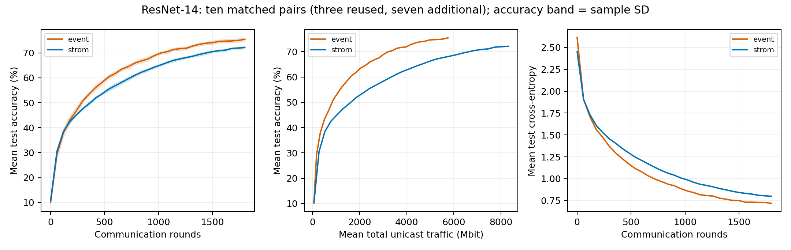

# ResNet-14 ten-pair confirmation: results and paper decision

Evidence: `experiments/results/resnet14_ten_seed_v1/`, results commit
`3c55b175a90fdef579a25a63fdbe2242e0674916`. Protocol:
[`RESNET14_TEN_SEED.md`](RESNET14_TEN_SEED.md). All **fourteen new runs and six
verified pilot reuses** are complete. There are no missing or failed outcomes.

## Conclusion

**The seven new pairs confirm the pilot result: the frozen Event configuration
achieves better predictive quality and lower communication than calibrated
Ström in this ResNet-14 setting.** Across all ten matched pairs, Event improves
round-1800 test accuracy by **3.308 percentage points [2.835, 3.781]**, reduces
test CE by **0.081343 [0.066382, 0.096304]**, and saves **30.74% [30.46%,
31.01%]** of final conservative unicast traffic. Event has higher accuracy,
lower CE and fewer final bits in **10/10 pairs**.

The seven prospective new pairs alone give **+3.209 pp [2.499, 3.918]** in
accuracy and **30.61% [30.26%, 30.95%]** final traffic savings, with the same
directions in **7/7 pairs**. The result therefore does not depend on pooling
the previously inspected three-pair pilot into the analysis.

At the unchanged 50% accuracy target, Event uses **51.44% [48.74%, 54.00%]
fewer unicast bits** and reaches the target in fewer saved rounds in all ten
pairs. This supports the paper's communication-to-predictive-quality argument
and adds a confirmed final predictive-quality advantage over the closest
pulse comparator in this benchmark.

Freeze this Event/Ström ResNet block. No additional tuning or seed extension
of these two settings is needed to resolve the question posed by this study.
The remaining experimental gap for a five-method ResNet comparison is the
matching Dense FedAvg, STC and EF-TopK panel, rather than more repetitions of
this already completed contrast.

## Fixed protocol and provenance

Use CIFAR-10, Torch ResNet-14 with GroupNorm (**175258 parameters**), ten fully
participating clients, strong 55%-dominant label skew, initialization seed
7777, five local SGD steps, batch size 32, local learning rate 0.05 and L2
coefficient 0.0005. All runs refit from initialization on the full 50000-image
training set, evaluate the fixed official 10000-image test set, and use a
5000-image training diagnostic subset. Final endpoints are round 1800, with
evaluation saved at round 1 and every 60 rounds.

Event remains threshold **0.01**, initial quantum **0.0025**, quantum exponent
0.2/scale 100, leak 0.999, persistent state, full reset and server gain 1.
Ström remains threshold **0.005**, FedAvg-equivalent gain **2** / native gain
**0.10**, nonleaky subtractive residual and one pulse per coordinate/client/round.
Both retain the actual shared lossless position and exact aggregate downlink
codecs, preserving their different native optimization updates.

Selections are unchanged after the
[`bounded validation boundary check`](RESNET14_BOUNDARY_RESULTS.md). The three
pilot partition seeds **7100/7200/7300** are reused exactly; the new seeds are
**7400–8000 in increments of 100**. Shared SGD seeds are **97100–98000**.
Each pair shares data allocation, initialization, minibatch RNG and evaluation
indices. The seven new pairs were not used for tuning. Development checkpoints
do not initialize the full-training runs.

## Final predictive quality and communication

Accuracy and CE are arithmetic mean +/- sample SD across ten matched pairs.
Traffic is the arithmetic mean; **1 Gbit = 10^9 bits**. Paired ratio estimates
and intervals are computed separately within seeds, on the log scale.

| Round-1800 metric | Event | Calibrated Ström |
|---|---:|---:|
| Test accuracy | **75.465 +/- 0.571%** | 72.157 +/- 0.517% |
| Test CE | **0.717770 +/- 0.016524** | 0.799113 +/- 0.014260 |
| Uplink, Gbit | **0.944** | 1.823 |
| Unicast downlink, Gbit | **4.808** | 6.482 |
| Total unicast, Gbit | **5.752** | 8.305 |
| Total logical broadcast, Gbit | **1.425** | 2.471 |

| Paired effect | All ten pairs [95% interval] | Seven new pairs [95% interval] |
|---|---:|---:|
| Event-minus-Ström accuracy, pp | +3.308 [+2.835, +3.781] | +3.209 [+2.499, +3.918] |
| Event-minus-Ström test CE | -0.081343 [-0.096304, -0.066382] | -0.081533 [-0.103514, -0.059553] |
| Final total unicast saving | 30.74% [30.46%, 31.01%] | 30.61% [30.26%, 30.95%] |
| Final uplink saving | 48.20% [47.92%, 48.49%] | 48.09% [47.70%, 48.48%] |
| Final unicast downlink saving | 25.82% [25.55%, 26.09%] | 25.68% [25.36%, 26.00%] |
| Final total logical-broadcast saving | 42.33% [42.05%, 42.62%] | 42.22% [41.83%, 42.60%] |

The seven new pairs have mean accuracy **75.323% versus 72.114%**, mean CE
**0.720921 versus 0.802454**, and mean final total unicast **5.765 versus
8.307 Gbit**. Final accuracy gains across all ten pairs range from **2.15 to
4.17 pp**. Both upload and download are lower for Event in every pair.
The communication result survives conservative recipient replication and
does not depend on logical-broadcast accounting.

Mean worst-class test accuracy is 54.61% versus 47.54%, favouring Event in
10/10 pairs. This is an additional descriptive quality diagnostic, rather
than a separately confirmed primary endpoint. Accuracy and CE already agree
on the main predictive comparison.

## Communication to declared accuracy targets

Both methods reach **45%, 50% and 55% accuracy in 10/10 runs**, including 7/7
new runs per method. There is no censored target in the completed data.
Costs and rounds below are arithmetic means of within-run first crossings.

| Target | Mean Event / Ström first saved round | Mean Event / Ström unicast Gbit | Event saving, all ten [95% interval] | Saving, seven new [95% interval] |
|---|---:|---:|---:|---:|
| 45% | 252 / 264 | 0.724 / 1.155 | 37.23% [32.68%, 41.47%] | 38.31% [31.42%, 44.52%] |
| 50% | 306 / 414 | 0.893 / 1.837 | 51.44% [48.74%, 54.00%] | 50.65% [46.52%, 54.46%] |
| 55% | 438 / 558 | 1.316 / 2.505 | 47.54% [44.24%, 50.64%] | 46.42% [41.84%, 50.63%] |

Event uses fewer bits at all three targets in every pair. At 45%, it is earlier
in two pairs and ties the sampled round in eight. At 50% and 55%, it is earlier
in all ten pairs. The result combines cheaper messages with fewer rounds to
the latter targets; a universal earlier-round claim at every accuracy level
would be too broad.

Targets were fixed before confirmation. Crossings are the first saved
evaluations, without interpolation or a requirement that later evaluations
stay above the target. All runs continue to 1800 rounds. These are retrospective
communication-to-quality diagnostics, not test-driven early stopping, an
asymptotic convergence-rate result or measured wall-clock/energy savings.



## Codec and training diagnostics

Mean total coordinate events are **133.21 million for Event versus 311.79
million for Ström**. In the final 120 rounds, the mean fraction of firing
client coordinates is **4.67% versus 10.49%**. Both use the same codec portfolio;
the difference is not an Event-only representation advantage.

Event selects the exact counts-plus-patch aggregate downlink in all 1800 rounds
of each run. Ström uses that representation in 1797 rounds and ordered replay
in three, for every seed. Floating-point fidelity corrections account for
about **0.98% versus 0.52%** of total unicast cost, respectively. Those costs
are included; an approximate integer-only update is not substituted.

Mean regularized training objective is **0.830630 versus 1.206238**, training
CE is **0.444459 versus 0.643012**, L2 penalty is **0.386172 versus 0.563226**,
and parameter norm is **39.302 versus 47.463**. Event has lower CE and lower
regularization cost under the common objective here. This agrees with its
test result but does not identify a causal generalization mechanism. Leak,
reset, quantum scheduling and operating-point effects have not been isolated
by this two-configuration confirmation.

## Paper claim, limits and next step

A supported numerical statement is: in this matched CIFAR-10 ResNet-14
experiment, the frozen Event configuration improves final test accuracy by
3.31 pp over calibrated Ström, uses 30.7% fewer final conservative unicast bits,
and uses 51.4% fewer bits to reach 50% accuracy across ten matched pairs.
Seven new prospective pairs confirm the direction and similar magnitude.

These intervals are descriptive, paired, unadjusted Student-t intervals;
cost ratios use the log scale. They describe partition/SGD variation under
one shared initialization, selected configurations and one previously
inspected CIFAR-10 test set. They do not include uncertainty over tuning,
new datasets or initialization choice. The bounded searches do not establish
global operating-point optimality.

This is stronger than the compact-CNN Event/Ström final-quality contrast,
which left its accuracy difference unresolved. However, the architecture,
NumPy/Torch backend and selected numerical parameters change together between
those experiments. An increased advantage caused specifically by network
size is not identified.

The current Event/Ström ResNet confirmation is complete and ready to support
the architecture-transfer part of the manuscript. The next experimental
priority is **Dense FedAvg, STC and EF-TopK in this same Torch ResNet protocol**,
with bounded validation-only calibration before matched evaluation. Reuse
these twenty frozen pulse outcomes in that later panel. Until it is complete,
keep the five-method compact-CNN ranking separate and do not claim a
five-method ResNet ranking or field-wide SOTA. Further Event/Ström tuning or
additional seeds would not address that remaining comparator-coverage gap.

## Reproducible saved-evidence audit

The supplementary audit verifies **fourteen complete new receipts, six reuse
receipts, 36000 round records, 620 sampled model fingerprints and twenty
distinct final fingerprints**. It verifies full-training partition manifests,
source/configuration identities and exact preservation of all reused pilot
metrics and counters. It reproduces all six original analysis CSVs and
independently reconstructs traffic prefixes/endpoints, paired intervals for
both scopes and target crossings/coverage from raw saved evaluations.

All **94 original campaign files**, including figures, remain byte-for-byte
unchanged during the audit. The audit writes only supplementary `analysis_*`
tables and an audit JSON. It reads saved counters, metrics and hashes, not
image arrays, packet bytes or NPZ model/state arrays, and does not replay
training. Runtime codec decoding and client reconstruction are checks of
the frozen runner. Saved execution is Windows / RTX 4090 / Torch 2.5.1 /
CUDA 12.1 with deterministic float32, no TF32 or mixed precision.

Reproduce the audit without training or overwriting original outputs:

```bat
python experiments/resnet14_ten_seed_audit.py
git add experiments/results/resnet14_ten_seed_v1
git commit -m "Refresh ResNet14 ten-seed evidence audit"
git push origin main
```
