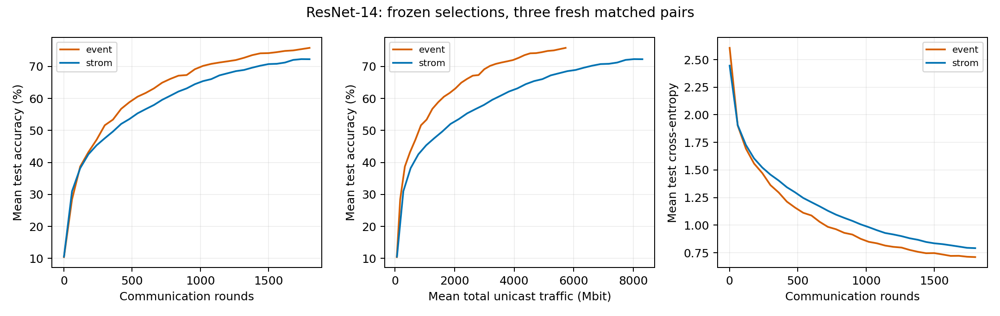

# ResNet-14 transfer: results and interpretation

Evidence: `experiments/results/resnet14_transfer_v1/`, results commit
`f8e740b1a888eee83200d82f9a92333543b16bba`. The protocol is frozen in
[`RESNET14_TRANSFER.md`](RESNET14_TRANSFER.md). All thirty 600-round screening
runs, four 1800-round finalists and six fresh confirmation runs are complete;
there are no failed or omitted candidates or confirmation pairs.

## Conclusion

**The selected Event configuration has higher final predictive accuracy and
lower communication than the selected Ström configuration in all three fresh
ResNet-14 pairs.** At 1800 rounds, mean accuracy is **75.797% versus 72.257%**,
and the paired difference is **+3.540 percentage points [2.808, 4.272]**. Event
also has lower test CE in all three pairs. Its paired final unicast saving is
**31.04% [30.51%, 31.56%]**; its saving to the declared 50% accuracy target is
**53.24% [52.68%, 53.79%]**.

This supports transfer of the communication-to-accuracy advantage to this
larger-network setting. It adds evidence of better predictive performance for
these selected configurations, beyond a reduction in encoded message size.
It is a three-pair comparison after bounded calibration, not a ten-seed
confirmation or a claim of optimal tuning. Both choices touch lower search
boundaries, especially Ström's threshold and gain. Resolve that specific
calibration limitation before treating this as the final ResNet comparison.

## Selection and experimental scope

The model is the Torch CIFAR ResNet-14 with GroupNorm, **175258 parameters**.
Ten clients participate in every round with 55%-dominant label skew. Both
methods use five local SGD steps, batch size 32, learning rate 0.05, L2
coefficient 0.0005 and initialization seed 7777. Each receives the same lossless
pulse-position encoder and exact aggregate downlink portfolio. Primary costs
include initialization, complete frames/padding, per-client requests and
downlink replication to every client under conservative unicast accounting.

Development uses a training-only 45000/5000 split, partition seed 7000 and SGD
seed 97000. Each family receives fifteen 600-round candidates and two exact
continuations to 1800 rounds. Promotion and final selection use validation CE,
then unicast traffic, then point ID. No official test curves select the
configuration or stop training. Confirmation starts from initialization using
all 50000 training images, partition seeds **7100/7200/7300** and matched SGD
seeds **97100/97200/97300**.

| Method | Frozen configuration | Validation CE at 1800 | Validation accuracy | Unicast Mbit at 1800 |
|---|---|---:|---:|---:|
| Event | Threshold 0.01; initial quantum 0.0025; quantum exponent 0.2; leak 0.999; gain 1 | 0.717497 | 75.78% | 5788.25 |
| Ström | Threshold 0.005; FedAvg-equivalent gain 2 / native gain 0.10 | 0.788567 | 72.50% | 8282.91 |

Event's other promoted finalist, threshold 0.0125 / quantum 0.0025, finishes at
validation CE 0.751855. Ström's other finalist, threshold 0.01 / equivalent gain
2, finishes at 0.809357. Neither replaces the corresponding frozen winner.
The choice is the best promoted finalist; the other thirteen settings per
method were not all trained to 1800 rounds.

The compact-CNN operating points are represented in the screening grid but are
not selected here. Architecture-specific calibration matters: these results do
not support using identical numerical thresholds/quantum on every network.
Relative to the compact-CNN study, both architecture and NumPy/Torch backend
change, so the change in effect size cannot be assigned to architecture alone.

## Final predictive quality and communication

Accuracy and CE below are arithmetic mean +/- sample standard deviation across
three matched pairs. Traffic is the arithmetic mean; **1 Gbit = 10^9 bits**.
Paired savings are computed separately from within-seed ratios on the log scale.

| Metric at round 1800 | Event | Ström |
|---|---:|---:|
| Test accuracy | 75.797 +/- 0.332% | 72.257 +/- 0.038% |
| Test CE | 0.710418 +/- 0.016692 | 0.791318 +/- 0.003992 |
| Uplink, Gbit | 0.938 | 1.820 |
| Unicast downlink, Gbit | 4.786 | 6.479 |
| Total unicast, Gbit | 5.724 | 8.300 |
| Total logical broadcast, Gbit | 1.417 | 2.468 |

| Paired effect | Estimate [descriptive 95% interval] |
|---|---:|
| Event-minus-Ström test accuracy, pp | +3.540 [+2.808, +4.272] |
| Event-minus-Ström test CE | -0.080899 [-0.121962, -0.039836] |
| Event final uplink saving | 48.46% [48.06%, 48.87%] |
| Event final unicast downlink saving | 26.14% [25.56%, 26.72%] |
| Event final total unicast saving | 31.04% [30.51%, 31.56%] |
| Event final total logical-broadcast saving | 42.61% [42.17%, 43.04%] |

Event has higher accuracy, lower CE, fewer upload bits, fewer download bits and
fewer total bits in **3/3 pairs**. The total saving therefore survives conservative
unicast accounting and does not depend on treating downlink as a free broadcast.
Logical broadcast remains supplementary; neither accounting convention measures
physical network latency, energy or elapsed training time.

Unlike the compact-CNN confirmation, the final accuracy and CE contrasts both
favour Event with descriptive intervals excluding zero. The compact-CNN
Event/Ström contrast was +0.267 pp [-0.435, +0.969], with a 3.91% final unicast
saving. The ResNet comparison is a stronger observed result in its own protocol,
not a formal test that the advantage increases with network size.

## Communication to the declared accuracy targets

Both methods reach all three fixed targets in **3/3 runs**. Crossings are the
first saved evaluations at round 1 or a multiple of 60, without interpolation.
They are retrospective diagnostics; all runs continue to 1800 rounds.

| Test accuracy target | Mean Event / Ström first saved round | Mean Event / Ström unicast Mbit | Event paired saving [95% interval] |
|---|---:|---:|---:|
| 45% | 240 / 240 | 683.81 / 1045.85 | 34.62% [33.69%, 35.53%] |
| 50% | 300 / 420 | 871.32 / 1863.19 | 53.24% [52.68%, 53.79%] |
| 55% | 420 / 560 | 1253.65 / 2514.07 | 50.06% [41.67%, 57.25%] |

Event uses fewer bits at every target in every pair. At 45%, both methods reach
the target at the same sampled round; the saving comes from cheaper messages.
At 50% and 55%, Event also reaches the target in fewer sampled rounds in every
pair. This supports lower communication to specified predictive quality and
fewer rounds to those targets. It does not establish an asymptotic convergence
rate or faster wall-clock execution. These targets were declared before this
confirmation; no new target was chosen from the favorable test curves.



## Codec and regularization diagnostics

The methods share the position and exact aggregate codecs, preserving their
different native state/reset/update rules. Mean total coordinate events are
**132.09 million for Event versus 311.18 million for Ström**. During the final
120 rounds, the mean fraction of firing client coordinates is **4.61% versus
10.49%**. These observations help describe the lower traffic, but the study
does not isolate leak, reset or quantum scheduling as its causal explanation.

The exact counts-plus-patch aggregate downlink is selected in all 1800 rounds
of each Event run and in 1797 rounds of each Ström run; the remaining three
Ström rounds use ordered replay. The floating-point fidelity correction costs
about 0.97% of Event's total unicast traffic and 0.52% of Ström's. Both totals
include that cost. A cheaper integer-only approximation is not substituted.

The mean regularized training objective is **0.824200 versus 1.197305**; mean
training CE is **0.439136 versus 0.634081**. Mean L2 penalties are 0.385064
versus 0.563223 and mean parameter norms are 39.246 versus 47.464. Here Event
has both lower CE and lower regularization cost under the common objective.
This is consistent with the favorable test result, without proving a particular
generalization mechanism or convergence theorem.

## Limits and next decision

The largest unresolved issue is the **search boundary**. Event selects initial
quantum 0.0025, the smallest tested value. Ström selects threshold 0.005 and
equivalent gain 2, both the smallest tested values. A boundary optimum does not
invalidate this predeclared comparison, and the completed study performed no
automatic extension. It does prevent calling either choice fully optimized.
The present data cannot show whether an extension would narrow, widen or leave
the gap unchanged.

Before a larger confirmation or the remaining ResNet baselines, the focused
next experiment should be a **small, symmetric validation-only boundary
sensitivity check** for both families. Preserve this completed pilot and its
selection unchanged. Predeclare the small additional grid and equal budget,
use the same training holdout and validation-CE rule, and do not select from
these official test results. If the check changes a selected configuration,
evaluate the new frozen comparison on fresh matched confirmation seeds. This
is a separate follow-up, not a retroactive amendment to the current protocol.

The three pairs quantify partition/SGD variation conditional on one development
split, one shared initialization, the selected configurations and one previously
inspected CIFAR-10 test set. Intervals are paired, unadjusted Student-t intervals
(log scale for ratios), descriptive with n=3. They do not include tuning or
dataset uncertainty. Dense, STC and EF-TopK have not yet been compared under this
new ResNet protocol; the completed five-method compact-CNN evidence remains a
separate experiment. No field-wide SOTA or general cross-device/participation
claim follows from this result.

## Reproducible audit

The supplementary audit verifies **40 complete stage receipts, 36000 archived
round rows, 640 sampled model fingerprints and four exact 600-to-1800 prefixes**.
The archived totals contain the four duplicated 600-round finalist prefixes;
unique scheduled work is **33600 rounds and 596 evaluation points** across 36
fresh trajectories. It reproduces all eight original analysis CSVs and
independently checks frame accounting, every saved traffic prefix/endpoint,
paired intervals, first target crossings and coverage. All three pairs are
retained, and all six final model fingerprints are distinct.

Saved sources, configuration/data fingerprints and runtime are consistent with
the frozen protocol. Execution was recorded on Windows with an RTX 4090,
Torch 2.5.1, CUDA 12.1, deterministic float32, no TF32 or mixed precision.
The audit reads saved evidence and hashes, without loading images, packet
bytes or NPZ model arrays, or replaying training. Runtime byte decoding and
client reconstruction are checks performed by the frozen training runner.
The fourteen original selection/analysis/figure files remain unchanged.

The audit writes only supplementary `analysis_*` tables and an audit JSON:

```bat
python experiments/resnet14_transfer_audit.py
git add experiments/results/resnet14_transfer_v1
git commit -m "Refresh ResNet14 transfer evidence audit"
git push origin main
```
