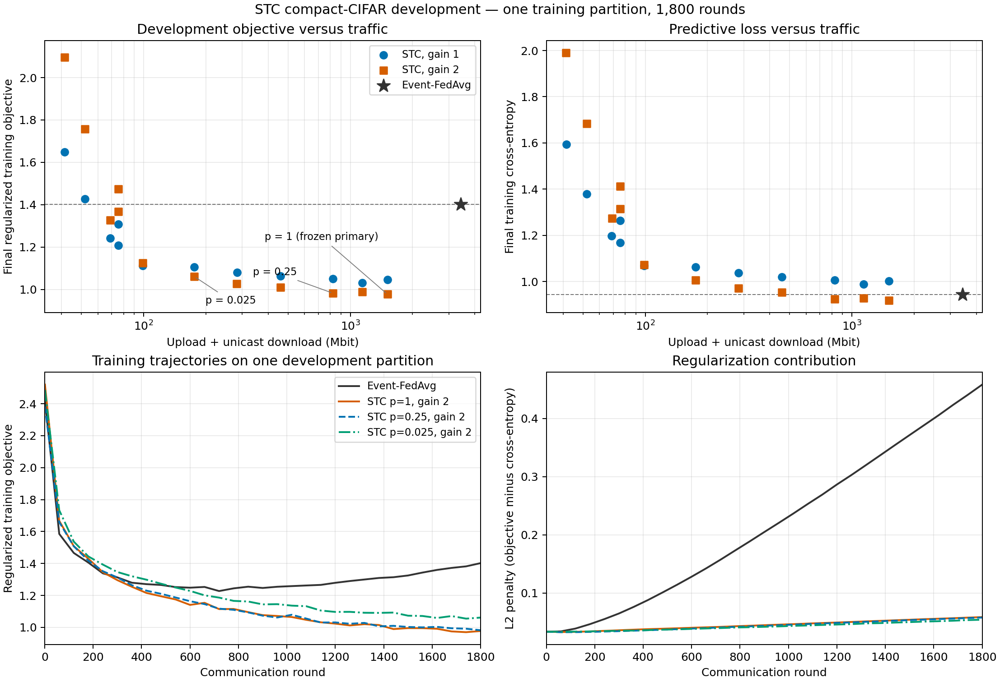

# STC compact-CIFAR development results

Results commit: `562ef8a274f40747a143626f1a84b24c2c365409`.
Protocol: [STC_CIFAR10_DEVELOPMENT.md](STC_CIFAR10_DEVELOPMENT.md).
Scope: one development partition, 1800 rounds, training metrics only.

**Decision:** keep the existing frozen primary `stc_u1_d1_g2` and confirm it on
the ten paired compact-CIFAR evaluation seeds before expanding to the other
benchmarks. STC is a necessary comparator. This study does not yet establish
the final test-accuracy ranking.

## Evidence verification

All 25 declared runs completed to round 1800 with no numerical failures. The
six frozen source hashes, configuration/seed metadata, history horizons and
endpoint accounting pass the original campaign checks. The selection rule
reproduces the full frozen selection, and the three aggregate development
tables reproduce from per-point files.

Git normalized the Windows CRLF text files to LF. This makes the original
byte-only verification command fail in an LF checkout. All **25 receipt hashes
and 50 CSV hashes** match their recorded values exactly after restoring CRLF.
There are no unexplained content differences. The new read-only auditor restores
only a matching representation in a temporary directory, then invokes the
unchanged original verifier and selection code there. It does not replace
receipts, edit the frozen selection or change the campaign source contract.

Run from the research-code repository:

```
python experiments/stc_cifar10_development_audit.py
```

Three transport tests cover CRLF-to-LF transfer, LF-to-CRLF checkout and rejection
of a changed numeric value. The recorded training runtime is Windows, Python
3.11.16, NumPy 1.26.4, pandas 2.2.3, one BLAS/OpenMP thread per worker. Dataset
batch hashes are recorded in the protocol; this read-only audit does not download
or independently rehash the raw dataset.

## Main development measurements

Traffic is upload plus conservative-unicast download, including initialization
and protocol overhead. `p` is the retained fraction in each parameter tensor;
the rows below use the same fraction for upload and download.

| Method / parameters | Training objective J | Training cross-entropy | L2 penalty J−CE | Upload, Mbit | Download, Mbit | Total, Mbit |
|---|---:|---:|---:|---:|---:|---:|
| Event-FedAvg reference | 1.402342 | 0.944151 | 0.458191 | 310.844 | 3115.598 | 3426.441 |
| STC p=1, gain 2, frozen primary | 0.977204 | 0.918501 | 0.058703 | 752.112 | 759.271 | 1511.383 |
| STC p=0.25, gain 2 | 0.981975 | 0.924144 | 0.057832 | 409.307 | 415.889 | 825.196 |
| STC p=0.025, gain 2 | 1.061275 | 1.007134 | 0.054141 | 84.179 | 91.306 | 175.485 |

The full numeric audit is in
[`analysis_key_points.csv`](results/stc_cifar10_development_v1/analysis_key_points.csv).



## Interpretation

### 1. The declared selection produces one primary configuration

Both the best training objective and the best objective within Event-FedAvg's
communication budget select `stc_u1_d1_g2`: upload fraction 1, download fraction
1, constant server gain 2. All 24 tested STC configurations use fewer total
unicast bits than the Event reference. Even the nearest traffic point remains
55.9% below that budget, outside the declared 10% proximity band.

Accordingly, the two selected roles coincide. This is a within-budget comparison,
not a matched-traffic comparison. Only one unique primary STC configuration needs
confirmation. `p=1` transmits essentially every coordinate: it is **dense ternary
STC with client/server error feedback**, rather than a sparse coordinate pattern.
It still quantizes, so it is distinct from Dense FedAvg. Gain 2 is the previously
declared common optimizer extension; the original gain-1 variant was also tested.

### 2. The regularized objective gap mainly reflects parameter norm

The common code uses `J = CE + (lambda/2) * ||w||^2`, with lambda=0.0005 applied
to the full parameter vector. Relative to Event-FedAvg, the frozen STC primary
has 30.3% lower J, but only **2.7% lower training cross-entropy**.

The objective difference is 0.425138. Of this, 0.399488 (94.0%) comes from the
L2-penalty difference and 0.025650 comes from cross-entropy. The corresponding
parameter norms inferred from the penalty are approximately 42.81 for Event
and 15.32 for the STC primary. A 30% objective improvement must therefore not
be described as a 30% improvement in prediction or accuracy.

Event reaches its smallest sampled J at round 720 (1.227355), then ends at
1.402342. Its cross-entropy continues improving from 1.069881 to 0.944151 over
the same interval; the rising objective reflects the growing norm penalty.
These observations do not isolate leakage, reset or quantization as the cause.

Nineteen STC points have both lower J and lower total unicast traffic than Event;
only three have both lower training cross-entropy and lower total traffic.
Those three use gain 2 and fractions 0.25, 0.5 and 1. No tested gain-1 STC point
has lower final training cross-entropy than Event. The distinction between J
and CE materially changes the apparent frontier.

### 3. The primary communication advantage is in the downlink

The primary uses 55.9% fewer total unicast bits, but uploads **2.42 times as many
bits** as Event-FedAvg. Its unicast download is 75.6% smaller. STC compresses the
aggregated server update with its own residual, whereas Event's current protocol
replays the client packet stream. The result compares complete communication
protocols; it does not isolate client event selection as the source of savings.

The network accounting also matters. Under broadcast accounting, the primary
costs 827.982 Mbit versus Event's 622.346 Mbit. The blanket statement "STC uses
55.9% fewer bits" therefore needs the conservative-unicast qualifier. The sparse
25% point costs 450.839 Mbit under broadcast, illustrating a different tradeoff.

### 4. A sparse development point is also competitive

STC p=0.25, gain 2 has J=0.981975, only 0.49% above the primary, with 45.4% fewer
bits than the primary. It also has lower training cross-entropy and lower total
traffic than Event in this development run. This supports reporting the
development frontier rather than equating STC with the p=1 setting.

This observation does not change the frozen primary selection. Any additional
tested operating point would need an explicit decision made before inspecting
its evaluation results. Very sparse STC also trades predictive fit for traffic:
p=0.025, gain 2 has lower J than Event but higher cross-entropy (1.007134).

## Next experiment and manuscript implications

1. Confirm the **frozen primary only** on partition seeds 3500, 3600, ..., 4400
   with the paired SGD seeds 83500, 83600, ..., 84400, the same local training,
   1800-round horizon and complete traffic accounting. Both selection roles
   refer to the same configuration, so this requires **10 new STC runs**.
2. Compare final test accuracy/cross-entropy and traffic-to-target against the
   eligible existing Event, Dense FedAvg, EF-TopK and Ström-style records.
   Check protocol compatibility and baseline fidelity before reusing records;
   retain the dense scheduled-gain fairness control.
3. Use that result to decide the scope of the other benchmarks and ResNet
   integration. Do not infer held-out accuracy, confidence intervals or a
   universal ranking from this single development partition.

The current manuscript's communication-performance conclusions need this STC
confirmation. Table I must describe STC's server-based protocol and both residual
levels. The numerical setup must identify the dense-ternary or sparse operating
point, common FedAvg host and gain extension, and retain the explicit Ström-style
adaptation label. New manuscript edits remain red when the evidence
is integrated. This analysis does not change the manuscript or its frozen data.

## Follow-up decision before confirmation

The subsequent discussion predeclares p=0.25, gain 2 as a secondary operating
point, alongside the unchanged p=1, gain 2 primary. This strengthens the assessment
of the tradeoff before inspecting new STC test results and requires 20 new runs.
The protocol and runnable code are in
[STC_CIFAR10_CONFIRMATION.md](STC_CIFAR10_CONFIRMATION.md). The original
`frozen_selection.json` remains the authority for the primary.
