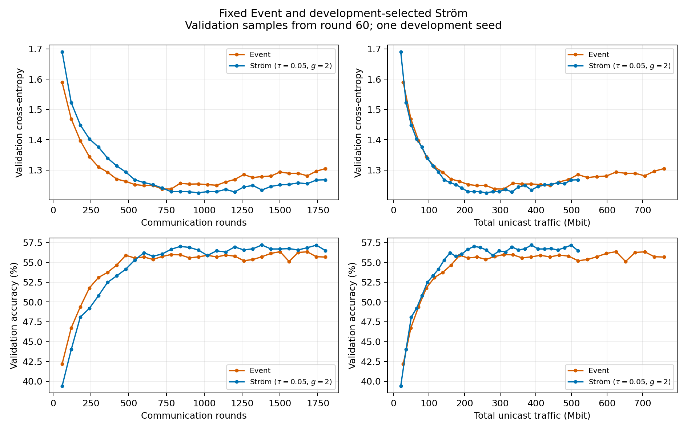

# Ström development study: results and decision

Evidence: `experiments/results/strom_codec_development_v1/`, results commit
`67eeec9`. One development partition/SGD seed (4500/84500), compact CIFAR CNN
(20570 parameters), ten fully participating clients and strong label skew.
Training uses 45000 CIFAR training images, with 5000 genuinely held-out training
images for validation. No official test images are parsed or evaluated in this
campaign. Event is fixed and rerun on exactly the same split.

## Decision

**The stronger Ström baseline reverses the earlier pilot comparison on this
development seed.** At round 1800, the selected Ström setting has lower
validation CE, +0.82 percentage points validation accuracy, and **31.85% less
total unicast traffic** than Event. It also uses fewer bits in each direction.
The current evidence therefore does not support a general Event advantage over
a calibrated residual-pulse baseline in communication to predictive quality.

The study achieves its baseline-development purpose. Freeze **threshold 0.05,
FedAvg-equivalent gain 2**, namely native server gain 0.10 with local learning
rate 0.05. This setting fills both the quality and within-Event-budget roles.
Keep Event fixed until a matched confirmation tests whether this development
result generalizes. These validation outcomes are not a multi-seed test result
or a statistically established ranking of the algorithm families.

## Selection and completeness

All **15 Ström settings and Event** complete the 600-round screen. The minimum
Ström endpoint validation CE occurs at `strom_t0p05_g2`, an interior point in
both threshold and gain. It already fits Event's round-600 unicast budget.
Consequently, the declared boundary rule adds **zero points**, and the two
selection roles deduplicate to **one Ström finalist**. Event and that finalist
continue exactly from their screening checkpoints to round 1800.

Selection follows final validation CE at each declared horizon, without best
checkpoint selection. It does not use validation accuracy, training objective
or residual size. For example, threshold 0.01/gain 4 has slightly higher
round-600 accuracy than the selected point, but worse CE and much greater cost.
The frozen decisions have not been changed after inspecting the results.

Only the promoted Ström setting receives a full-horizon run. This is a bounded
two-stage selection, not an exhaustive 1800-round search or evidence of global
optimality. Other settings, including cheaper threshold-0.1 points, remain in
the complete screening ledger rather than being silently treated as failures.

## Predictive quality and traffic at fixed horizons

Traffic is conservative unicast **Mbit**, using `both_codecs` for both methods.
It includes initialization, frames, padding, per-client requests and receiver
replication. Accuracy and CE below are **validation** metrics on one seed.

| Horizon | Method | Validation accuracy | Validation CE | Upload | Download | Total |
|---|---|---:|---:|---:|---:|---:|
| 600 | Event | 55.68% | 1.249093 | 39.95 | 194.47 | 234.42 |
| 600 | Ström, threshold 0.05/gain 2 | 56.22% | 1.259028 | 23.28 | 135.40 | 158.68 |
| 1800 | Event | 55.68% | 1.305046 | 131.26 | 628.81 | 760.07 |
| 1800 | Ström, threshold 0.05/gain 2 | 56.50% | 1.268014 | 77.52 | 440.50 | 518.02 |

At round 600 there is a CE/cost tradeoff: Event has lower validation CE, while
Ström has higher accuracy and lower traffic. At round 1800 Ström is better on
all these reported endpoint quantities. Relative to Event, its upload saving
is **40.94%**, download saving **29.95%**, and total saving **31.85%**. The
supplementary logical-broadcast total is also smaller: 121.51 versus 194.08
Mbit, a **37.39%** reduction. Changing accounting conventions does not restore
an Event advantage in this comparison.

The earlier ten-seed Event/STC results remain valid for their own experiment.
They used all 50000 training images and the official test set, whereas this
study uses a 45000/5000 training/validation split. Do not place the old STC test
scores and these validation scores into one numerical ranking. This campaign
does not establish a new Ström/STC ranking.

## Why tuning matters

Holding equivalent gain at 2, the round-600 threshold sweep gives:

| Ström threshold | Validation accuracy | Validation CE | Unicast total, Mbit |
|---:|---:|---:|---:|
| 0.0025 | 51.16% | 1.353395 | 645.93 |
| 0.01 | 55.00% | 1.282339 | 392.11 |
| 0.025 | 55.56% | 1.261549 | 248.44 |
| 0.05 | 56.22% | 1.259028 | 158.68 |
| 0.10 | 55.18% | 1.265255 | 104.00 |

Increasing threshold from 0.01 to 0.05 reduces total traffic **59.53%** and
raises validation accuracy **1.22 percentage points**, with lower CE. Thus
the broader search finds both better prediction and fewer messages; it is
not simply buying lower traffic by accepting a much worse predictor. Because
threshold also sets the residual discharge and pulse amplitude in this
baseline, the change alters the entire trajectory. It is not a lossless
recoding of the old small-threshold run.

Both pulse methods already receive the same lossless position and exact
aggregate-downlink opportunities. On their respective unchanged trajectories,
the codec reduces legacy traffic by 77.47% for Event and 69.99% for selected
Ström. A larger percentage codec saving does not imply lower absolute traffic
between algorithms. Both full-horizon runs select counts-plus-corrections in
all 1800 rounds; neither chooses an ordered fallback. Exact-fidelity corrections
are retained. Their costs are 12.77 Mbit for Event and 7.74 Mbit for Ström,
far smaller than the 242.05 Mbit endpoint traffic gap.

## Faster sampled progress is not lower communication

Use the same 45%, 50% and 55% accuracy thresholds as earlier comparisons, now
as retrospective **validation diagnostics**. Entries are first saved crossings
(round 1 or multiples of 60), without interpolation or an implemented early
stopping policy. The accuracies at the two crossings can overshoot differently.

| Validation target | Event round | Event, Mbit | Ström round | Ström, Mbit | Lower traffic |
|---|---:|---:|---:|---:|---|
| At least 45% | 120 | 48.92 | 180 | 50.04 | Event |
| At least 50% | 240 | 92.55 | 300 | 79.83 | Ström, 13.74% less |
| At least 55% | 480 | 185.75 | 540 | 142.34 | Ström, 23.37% less |

Event reaches each target in fewer sampled rounds. Its rounds cost more, so
that progress does not yield a traffic advantage at 50% or 55%. No wall-clock,
energy or asymptotic convergence claim follows from these curves.



Both curves flatten and their validation CE eventually rises while training
diagnostic CE continues to fall. Event's minimum saved validation CE is
1.237606 at round 780; Ström's is 1.224889 at round 960. These are post-hoc curve
diagnostics, not replacement selected endpoints. The frozen round-1800
comparison is retained.

At round 1800, Event's training diagnostic CE is actually lower (0.933394
versus 0.973363), while its L2 penalty is larger (0.471962 versus 0.214635).
The implied parameter norms are 43.45 and 29.30. Event's regularized training
diagnostic objective is therefore worse, 1.405356 versus 1.187998. Together
with increasing validation CE, these observations are consistent with a
generalization/parameter-growth issue, but do not identify its cause. The
training diagnostics use the fixed 5000-image training subset, not all local
training examples. No leak/reset/quantum component has been causally isolated.

Ström still has a growing residual backlog: its final norm is 482.95 in the
archived gradient-like units and its maximum residual is about 2381 thresholds.
Nevertheless, it beats Event at the final reported endpoint. Large backlog is
therefore not sufficient evidence that this baseline will perform worse, and
does not by itself justify adding leak or Event-style reset to the comparator.

## Audit and next scientific step

The saved-evidence audit verifies **18 completion receipts**, **13200 archived
round records**, **238 archived evaluated models**, the complete disjoint split,
and the frozen source/protocol identities. The two final trajectories reproduce
their 600-round round/evaluation/history prefixes exactly, apart from timing and
stage-horizon metadata. It independently reconstructs all four variants' traffic
histories and summaries from round counters and recomputes the CE/budget choices.
The prefix records are archived twice; unique coverage is 12000 rounds and
216 evaluated models across 16 trajectories.

The audit reads saved CSV/JSON evidence, not raw images, complete packets,
per-client residual arrays or NPZ models. Live decoding and client/server model
equality belong to the frozen execution host. The `active_clients` round field
counts nonempty pulse uploads; a silent upload does not imply a skipped local
SGD participant. No confidence interval or significance claim is appropriate
for this single development seed, whose validation scores selected the setting.

The next experimental comparison should **freeze threshold 0.05/native gain
0.10 and evaluate Ström on the same ten full-training partition/SGD seeds as the
completed Event/STC campaign**. Existing Event/STC trajectories can be reused
after their identities are verified, while Ström needs its own full-training
runs. This tests transfer of the selected operating point from development to
the matched comparison; it does not justify further tuning on those test curves.
The previously inspected seed and fixed, previously inspected official test
set must remain explicit when interpreting confirmation evidence.

For the paper, faster progress in rounds should currently be treated as a scoped
diagnostic rather than the central claim. A broad accuracy-per-bit claim also
remains unproven against this closest calibrated pulse baseline. Finish the
matched comparison before deciding whether a distinct Event mechanism needs
improvement or supports another application regime. Any algorithm redesign
should be a separately declared development study. Dense FedAvg and EF-TopK
remain part of the agreed final core comparison.

Reproduce analysis without training:

```bat
python experiments/strom_codec_development.py analyze
python experiments/strom_codec_development_audit.py
git add experiments/results/strom_codec_development_v1
git commit -m "Refresh validation-only Strom development analysis"
git push origin main
```
