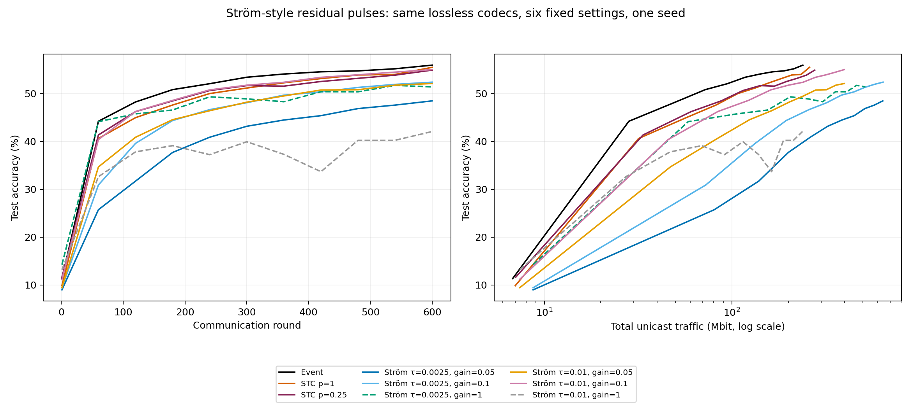

# Comparable Ström-style pulse pilot: results and decision

Evidence: `experiments/results/strom_codec_pilot_v1/`, results commit
`a6a3aaa`. One previously inspected CIFAR-10 partition (3500), SGD seed 83500,
compact CNN (20570 parameters), ten fully participating clients, **600
communication rounds**. Six new Ström-style trajectories are compared with
verified prefixes of the completed Event/STC trajectories. All use the same
local data, initialization, local SGD settings and L2 coefficient. Each method
receives the frozen lossless coding opportunities described in the protocol.

## Decision

**The shared codecs and gain normalization do not erase Event's observed early
accuracy-per-bit advantage in this pilot.** Against the Ström point with the
highest observed round-600 accuracy, Event has +0.93 percentage points accuracy,
lower test CE, and **39.88% less total unicast traffic**. At the predeclared
45%, 50% and 55% accuracy targets, its costs are 40.47%, 55.26% and 46.10% lower.

The gain correction substantially strengthens the comparator. The older
native-gain-1 settings must not remain its only representatives. However, the
two tested thresholds also produce large residual backlogs. The pilot therefore
closes the implementation/coding check, while leaving the final tuning and
confirmation of the Ström comparator open.

Keep Event unchanged. The next justified experiment is a bounded, separate
development/validation study of Ström threshold and gain, including thresholds
larger than 0.01, before freezing points for full-horizon matched evaluation.
The present test diagnostics do not select a final operating point.

## All six settings and the reused controls

All traffic below is conservative **unicast Mbit**, including framing, padding,
initialization, requests and receiver replication. Entries use `both_codecs`
for Event/Ström and `lossless_stc` for STC. Accuracy is a single-seed value.
Ström gains below are **FedAvg-equivalent**, namely native gain / local_lr;
native gains are 0.05, 0.10 and 1.00, respectively.

| Method / Ström threshold | FedAvg-equivalent gain | Test accuracy | Test CE | Upload | Download | Total |
|---|---:|---:|---:|---:|---:|---:|
| Event | — | **55.96%** | **1.251067** | 40.53 | 198.52 | **239.05** |
| STC p=1 | 2 | 55.50% | 1.259653 | 126.21 | 133.33 | 259.54 |
| STC p=0.25 | 2 | 54.92% | 1.270945 | 135.01 | 141.73 | 276.74 |
| Ström, tau=0.0025 | 1 | 48.49% | 1.441096 | 197.36 | 440.99 | 638.34 |
| Ström, tau=0.0025 | 2 | 52.40% | 1.332796 | 198.79 | 440.67 | 639.46 |
| Ström, tau=0.0025 | 20, legacy | 51.41% | 1.388872 | 169.97 | 345.26 | 515.24 |
| Ström, tau=0.01 | 1 | 52.12% | 1.344076 | 102.83 | 295.23 | 398.06 |
| Ström, tau=0.01 | 2 | 55.03% | 1.275756 | 100.44 | 297.21 | 397.65 |
| Ström, tau=0.01 | 20, legacy | 42.09% | 1.617701 | 46.86 | 191.31 | 238.17 |

The phrase "highest observed Ström accuracy" refers descriptively to
`strom_t0100_g010`. It does not label this point optimal, development-selected,
or frozen for confirmation. All six settings remain in every exported table.

At tau=0.01, reducing the equivalent gain from 20 to 2 raises accuracy by
**12.94 percentage points** and reduces test CE from 1.617701 to 1.275756.
Traffic rises because the changed model trajectory triggers more pulses. Gain
normalization improves the comparator's predictive quality; it does not reduce
the byte count on an otherwise identical trajectory.

Event uses 59.64% fewer upload bits and 33.21% fewer unicast download bits than
`strom_t0100_g010`. Its training objective is also lower: 1.243325 versus
1.335388. Training CE is 1.108682 versus 1.174569; L2 penalties are 0.134644
versus 0.160819, corresponding to inferred parameter norms 23.21 versus 25.36.
Thus this particular comparison favours Event on both prediction and the stated
regularized training objective. The STC objective comparison remains different:
STC p=1 has lower regularized training objective (1.192773).

STC p=1 remains the closest tested accuracy/communication control. At round
600 it has higher accuracy and lower traffic than the accuracy-leading Ström
point. The earlier ten-seed Event/STC confirmation remains necessary context;
the larger Event/Ström pilot gaps do not replace that stronger comparison.

## Fixed predictive targets

Compare Event with the accuracy-leading observed Ström setting only as a
descriptive diagnostic; all settings' target outcomes are preserved in
`traffic_to_target.csv` and `analysis_target_comparison.csv`.

| Target | Event round | Event, Mbit | Ström round | Ström, Mbit | Event saving |
|---|---:|---:|---:|---:|---:|
| At least 45% | 120 | 50.19 | 120 | 84.30 | 40.47% |
| At least 50% | 180 | 72.19 | 240 | 161.36 | 55.26% |
| At least 55% | 540 | 214.32 | 600 | 397.65 | 46.10% |

At 45%, the saving comes from fewer communicated bits at the same sampled round.
At 50% and 55%, it also includes earlier sampled progress. Actual accuracies at
the three saved crossings are Event 48.26%/50.84%/55.20%, versus Ström
46.27%/50.79%/55.03%. This is traffic to exceed a target, with potentially
different overshoot, rather than interpolation to exactly equal accuracy.

Only `strom_t0100_g010` reaches all three targets by 600. The other Ström points
are retained with explicit censoring where appropriate; failure to reach 55%
within this short horizon does not establish that it will never be reached.
The leading Ström curve is still improving at round 600. No asymptotic
convergence or final-horizon superiority follows from this pilot.



## The comparator receives a large coding benefit

For `strom_t0100_g010`, the original representation costs **3494.10 Mbit**,
while common lossless coding reduces it to **397.65 Mbit**, an **88.62%**
reduction on its unchanged trajectory. The algorithm comparison therefore
already grants the baseline a large representation improvement. Comparing Event
only against legacy Ström framing would greatly exaggerate Event's advantage.

The same exact-fidelity mechanism is applied to both pulse methods: aggregated
counts plus float32 corrections, or an ordered fallback. For the leading Ström
point, preserving exact historical arithmetic costs 7.01 Mbit above the
counts-only diagnostic, **1.76% of total unicast traffic**. Event's corresponding
overhead is 3.84 Mbit, **1.60%**. These small overheads cannot account for the
158.60 Mbit total-cost gap. Counts-only arithmetic is not substituted into the
reported exact results.

The leading Ström run uses 599 counts/patch downlinks and one ordered fallback.
The adapter preserves native residual updates, amplitude, gain and float32
operation order; Event's leak, reset and quantum schedule are not inserted into
the baseline.

## Residual backlog and the remaining fairness question

At tau=0.01 and native gain 0.10, residual norm grows from **2.565** after round
1 to **387.448** after round 600, in the archived gradient-like state units.
The final largest absolute residual is **96.281**, approximately **9628 times
the threshold**. In model units the residual norm is 38.745, while its maximum
coordinate is 9.628 and a single emitted coordinate pulse has model magnitude
0.001. During the last 120 rounds, 16.07% of client-coordinate opportunities
emit a pulse. The tau=0.0025 equivalent-gain-2 point fires in 65.35% of those
opportunities and also has a large backlog.

The recurrence has an integrator with a discharge capped at one threshold-sized
pulse per coordinate/round. These observations are consistent with a windup-like
backlog and delayed response. This is a **diagnostic inference**, not proof that
backlog causes the accuracy gap or that residual preservation is inferior.
The saved scalar diagnostics do not provide the coordinate-level residual and
gradient histories needed for that causal attribution. Event's full reset cannot be credited as
the isolated cause of the observed gain from this comparison.

The implementation/regression checks rule out the tested coding changes as a
cause of altered legacy trajectories. They do not establish that the two old
thresholds are well calibrated for the normalized gains, five-local-step
FedAvg input and 600/1800-round horizons. A broader, development-only threshold
and gain study is warranted. Keep the current one-pulse adaptation explicit;
changing the pulse cap or adding Event's independent quantum schedule would
define another variant and must not be silently folded into this baseline.

## Audit, scope and next step

All six completion receipts, frozen sources and recorded runtime/data identities
verify. There are 3600 new round records and 66 new evaluated models, plus three
verified reused 600-round prefixes. All five analysis CSVs reproduce. Both
native-gain-1 legacy curves match archived predictions/training metrics at
printed precision and native upload prefixes exactly. The normalized-gain runs
have no archived real-data curves; native model/residual equivalence was tested
synthetically for all six settings before the local campaign.

This audit reads saved evidence, without reloading raw images, complete packet
streams, per-client residual arrays or NPZ model checkpoints. Byte decoding and
client/server model identity were checked during execution by the frozen host.
This remains one previously inspected seed, six fixed settings and an early
horizon; there are no confidence intervals or test-based selections.

The next scientific step is **baseline development tuning**, with independent
training/validation diagnostics and a declared quality/communication selection
rule. Include larger thresholds and explicit model-unit gains, retain the
full trial ledger, and freeze the operating points before a full-horizon
multi-seed comparison. Keep Event fixed through that process. The current
result supports continuing the paper's communication-to-quality investigation;
it does not yet close its mechanism or generality claim.

Reproduce the analysis and audit without training:

```bat
python experiments/strom_codec_pilot.py analyze
python experiments/strom_codec_pilot_audit.py
git add experiments/results/strom_codec_pilot_v1
git commit -m "Refresh Strom-style codec pilot analysis"
git push origin main
```
