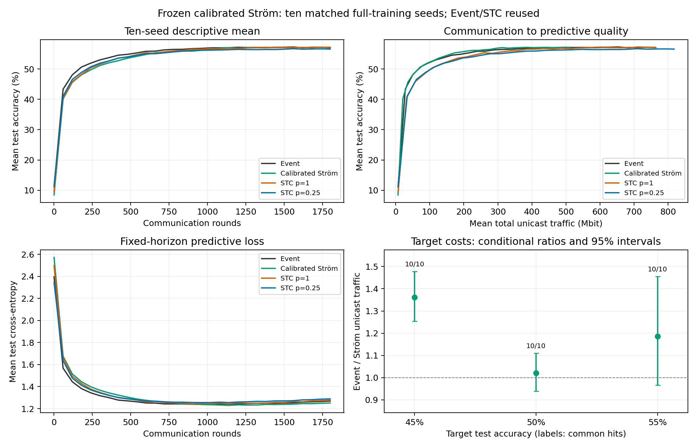

# Calibrated Ström confirmation: results and decision

Evidence: `experiments/results/strom_codec_ten_seed_v1/`, results commit
`b3b2d30`. Ten matched full-training partitions (3500,...,4400) and SGD seeds
(83500,...,84400), compact CIFAR CNN (20570 parameters), ten fully participating
clients, strong 55%-dominant label skew, **1800 communication rounds**. Ten new
Ström trajectories use the validation-selected threshold **0.05**, equivalent
gain **2**, and native gain **0.10**. Thirty completed Event/STC controls are
verified and reused. All methods train on 50000 images and evaluate the same
10000-image official test set. The 45000/5000 development checkpoint is excluded.

## Conclusion

**The calibrated residual-pulse baseline is a substantially stronger
communication comparator than the earlier pilot suggested.** Relative to Event,
Ström has **32.54% lower paired geometric-mean final unicast cost**, with fewer
upload, download and total bits in every seed. Its mean test cross-entropy is
also lower. The primary final-accuracy comparison does not establish a clear
difference: Event minus Ström is **+0.174 percentage points**, descriptive 95%
interval **[-0.430, +0.778]**. This is not evidence of formal equivalence.

The development study's communication advantage transfers to the ten-seed
comparison. Its single-seed accuracy advantage does not: the confirmation mean
accuracy is slightly higher for Event, with considerable paired uncertainty.
Do not promote either method as predictively superior on the basis of that
small accuracy difference.

Keep the calibrated Ström operating point as the principal pulse comparator.
The current evidence does not support a general Event advantage in total
communication to predictive quality. The earlier Event/STC findings remain
valid, but an STC-only comparison cannot establish superiority over this closer
pulse baseline. Stop Ström tuning for the present protocol and consolidate the
contribution before adding experiments.

## Final quality and communication

Accuracy and CE are **mean +/- sample standard deviation across ten seeds**.
Traffic is the arithmetic mean in Mbit, using `both_codecs` for Event/Ström and
`lossless_stc` for STC. Primary accounting is conservative unicast, including
initialization, frames, padding, requests and receiver replication.

| Method | Test accuracy, % | Test CE | Upload | Download | Total |
|---|---:|---:|---:|---:|---:|
| Event | 57.153 +/- 0.714 | 1.268987 +/- 0.017174 | 130.94 | 630.83 | 761.77 |
| Calibrated Ström | 56.979 +/- 0.657 | 1.251163 +/- 0.014651 | 76.81 | 437.16 | 513.97 |
| STC p=1 | 57.039 +/- 0.636 | 1.276928 +/- 0.015125 | 378.76 | 385.76 | 764.51 |
| STC p=0.25 | 56.574 +/- 0.870 | 1.289080 +/- 0.024944 | 405.56 | 412.22 | 817.78 |

Event has higher final accuracy in **6/10** matched seeds, while Ström has
lower CE in **9/10**. Mean Event-minus-Ström CE is **+0.017824**, interval
**[+0.005860, +0.029788]**. Accuracy uses the most likely class; CE also depends
on the assigned probabilities, so lower CE can coexist with slightly lower
top-1 accuracy. The CE interval is a descriptive secondary result, not a
replacement primary endpoint chosen after inspecting the accuracy finding.

Within-seed ratios are summarized geometrically, then transformed into savings
for Ström relative to Event:

| Direction/accounting | Ström reduction [descriptive 95% interval] | Ström cost wins |
|---|---:|---:|
| Upload | 41.35% [40.13%, 42.55%] | 10/10 |
| Unicast download | 30.72% [29.34%, 32.06%] | 10/10 |
| Total unicast | 32.54% [31.20%, 33.86%] | 10/10 |
| Logical-broadcast total | 37.91% [36.64%, 39.15%] | 10/10 |

The inverse ratio is easy to misstate: Event uses **48.25% more** final unicast
traffic than Ström; Ström uses **32.54% less** than Event. These percentages
have different denominators. Under logical broadcast, the arithmetic mean totals
are 193.97 Mbit for Event and 120.47 Mbit for Ström. Switching accounting
conventions does not restore an Event advantage here. Logical broadcast remains
a supplementary model, not a measured physical multicast, latency or energy cost.

Against STC p=1, Ström has **32.79% less** paired geometric-mean final unicast
traffic, interval **[31.52%, 34.04%]**. Its accuracy difference is -0.060 points,
interval [-0.650, +0.530], and its CE difference is -0.025765, interval
[-0.041044, -0.010487]. It uploads 79.73% fewer bits, while downloading 13.29%
more. It also uses 37.17% fewer total bits than STC p=0.25. These are comparisons
among the tested operating points; neither formal predictive equivalence nor
field-wide state of the art follows.

## Rounds and bits answer different questions

All four methods reach all three declared accuracy targets on all ten seeds.
Costs use each trajectory's **first saved crossing** at round 1 or a multiple
of 60. There is no interpolation, best-test-checkpoint selection or implemented
test-driven early stopping. Crossings can have different accuracy overshoot and
may subsequently fall below the target.

| Target test accuracy | Event/Ström unicast ratio [95% interval] | Event uses fewer rounds | Event uses fewer bits |
|---|---:|---:|---:|
| At least 45% | 1.361 [1.254, 1.478] | 1/10, with 9 ties | 1/10 |
| At least 50% | 1.021 [0.939, 1.111] | 10/10 | 5/10 |
| At least 55% | 1.186 [0.966, 1.456] | 9/10 | 3/10 |

At 50%, Event crosses at round 180 in eight seeds and 240 in two; Ström crosses
at 240 in three and 300 in seven. Faster sampled progress in rounds is a real
observation. The traffic advantage is not established: the cost interval includes
both cheaper and more expensive Event operation. The same is true at 55%, where
the point estimate favours Ström but the interval is wide. At 45%, Ström is
cheaper on average, with a saving of **26.53%**, interval [20.24%, 32.32%].

Event's advantage in rounds at 55% is not universal. On partition 3800, Event first crosses at
round 900 and 371.95 Mbit, versus Ström at round 600 and 161.59 Mbit. Conversely,
on partition 4000, Event crosses at round 420 and 168.10 Mbit, versus Ström at
840 and 211.59 Mbit. Preserve both outcomes in the complete paired analysis.

Against STC p=1, Ström reduces target costs by **38.18%, 30.81% and 33.42%** at
45%, 50% and 55%, respectively; all three descriptive intervals indicate lower
traffic for Ström. The previously reported Event/STC target advantages reproduce. The new
comparison shows why those advantages cannot be generalized to a calibrated
residual-pulse comparator.



The figure's mean-accuracy-versus-mean-bits panel is descriptive. The paired
target table, rather than that mean curve, defines the target-cost estimand.
Fewer rounds is not measured wall-clock acceleration. No deployment timing or
energy result is inferred from codec audit timings.

## Sensitivity to the inspected pilot

The development partition 4500 is outside this confirmation grid. Partition
3500 was previously inspected in earlier Event/STC and small-threshold Ström
experiments, so retain the predeclared sensitivity excluding it.

| Quantity | All ten seeds | Excluding partition 3500 |
|---|---:|---:|
| Event-minus-Ström accuracy, pp [95% interval] | +0.174 [-0.430, +0.778] | +0.158 [-0.529, +0.845] |
| Event-minus-Ström CE [95% interval] | +0.017824 [+0.005860, +0.029788] | +0.017514 [+0.003902, +0.031126] |
| Event/Ström final unicast ratio | 1.482 | 1.486 |
| Target-45% unicast ratio | 1.361 | 1.356 |
| Target-50% unicast ratio | 1.021 | 1.037 |
| Target-55% unicast ratio | 1.186 | 1.173 |

The main interpretation is unchanged: no established final-accuracy or
target-50%/55% traffic advantage for Event, with lower final traffic and lower
test CE for Ström. The official test set is fixed and has been inspected in
previous experiments; these are partition/SGD sensitivity results, not a new
blind test dataset.

## Representation and regularization diagnostics

Both pulse methods use counts-plus-float32-corrections in **all 18000
seed/round instances per method**, with no ordered fallback. Event emits a
mean of 19.00 million coordinate pulses per run, versus 9.58 million for Ström.
In the last 120 rounds, their mean firing fractions are 5.61% and 2.92% of
client-coordinate opportunities. These differences are consistent with the
traffic gap. They do not isolate the causal effect of leak, reset, threshold
or the quantum schedule.

Exact-fidelity corrections cost a mean 12.31 Mbit for Event and 7.64 Mbit for
Ström, about 1.62% and 1.49% of their respective total costs. They cannot
explain the roughly 247.80 Mbit final traffic gap. On their unchanged trajectories,
legacy-to-improved mean unicast costs are 3362.96 to 761.77 Mbit for Event,
1705.95 to 513.97 Mbit for Ström, 1511.38 to 764.51 Mbit for STC p=1, and
825.14 to 817.78 Mbit for p=0.25. Shared lossless coding is useful for both
pulse methods; its benefits cannot be assigned exclusively to Event.

Ström still has substantial residual backlog: final norms range from 428.82 to
560.03 in the archived gradient-like units, and maximum coordinate residuals
range from about 1972 to 3003 thresholds. Its lower communication and CE coexist
with that backlog. Backlog magnitude alone is therefore not evidence that a
full reset or leak is necessary for better predictive performance.

Mean regularized training diagnostics are 1.397003 for Event, 1.157321 for Ström,
and 0.990651 for STC p=1. Their training CEs are 0.926459, 0.948707 and 0.932903;
mean L2 penalties are 0.470544, 0.208614 and 0.057749, with mean inferred norms
43.38, 28.82 and 15.20. Event's larger objective is driven by its penalty despite
lower training CE. Ström's better test CE does not mean it minimizes the stated
regularized training objective better than STC. These diagnostics use the fixed
5000-image training subset and do not establish a causal regularization mechanism.

## Audit and paper decision

The audit verifies all **ten new Ström and thirty reused Event/STC receipts**,
**72000 round records** and **1240 sampled model fingerprints**. It reconstructs
all eight original analysis CSVs, independently checks all traffic prefixes
and endpoint totals from saved round counters, and independently recomputes the
paired intervals and target-coverage counts. The original Windows analysis is
preserved; statistical comparisons allow 1e-10 for tiny cross-runtime SciPy
quantile differences. No missing or failed seed is excluded.

The audit reads saved scientific evidence, not raw images, actual packet bytes,
NPZ model weights or per-client residual arrays. Byte decoding and client/server
model equality were checked during the frozen execution. Intervals are
descriptive and unadjusted for multiple comparisons, with uncertainty across
partition/SGD seeds on one fixed test set. No formal noninferiority/equivalence,
causal mechanism, physical-network or larger-model claim is established.

This closes the calibrated Ström confirmation for the current setup. Preserve
its selected setting and the complete comparison. Dense FedAvg and EF-TopK
still belong in the final core set under common accounting. Before another
Event experiment, identify a distinct useful property that the proposed
mechanism should deliver beyond a residual-pulse baseline with the same encoder.
Generic communication superiority is currently unsupported; the early-round
observation is too narrow by itself to carry that broader claim. Any algorithm
redesign should have a separate development protocol and retain calibrated
Ström as a fixed control.

Reproduce the saved-evidence audit without training or overwriting the original
analysis:

```bat
python experiments/strom_codec_ten_seed_audit.py
git add experiments/results/strom_codec_ten_seed_v1
git commit -m "Refresh calibrated Strom ten-seed evidence audit"
git push origin main
```
